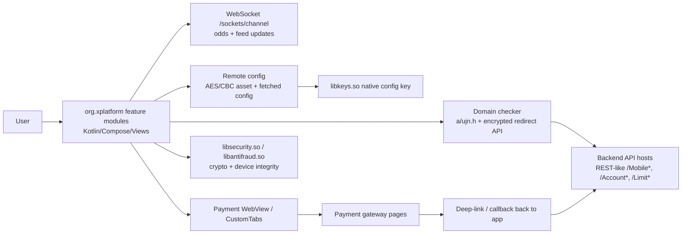
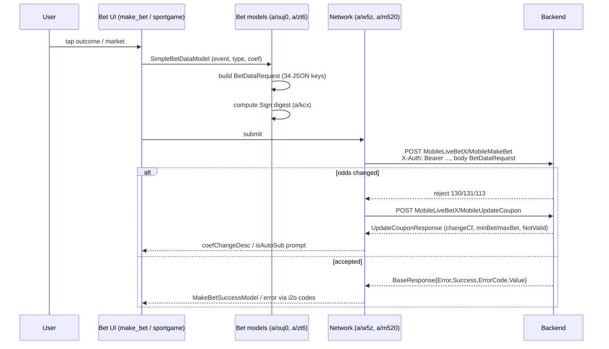
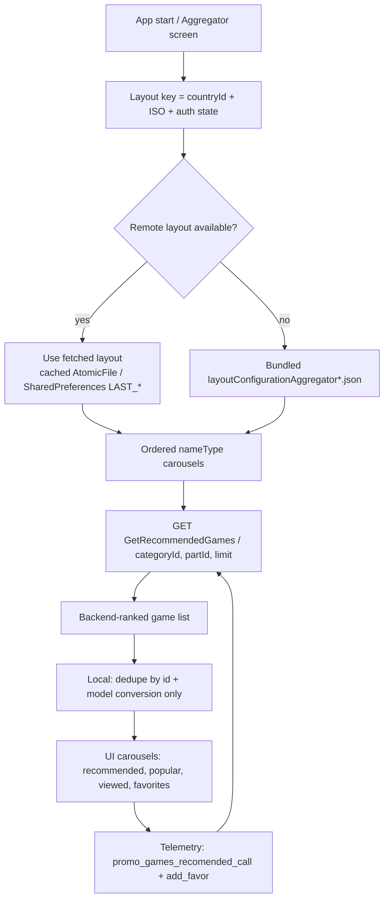
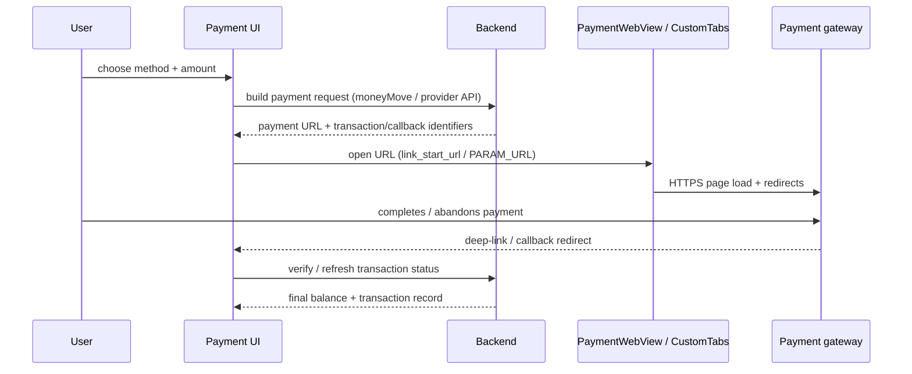
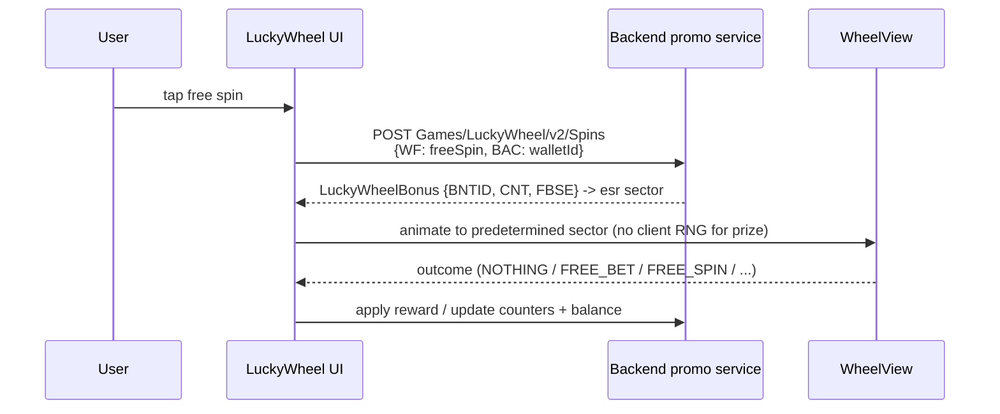

# Cross-Cutting Synthesis (for final report assembly)

## 1. Executive Summary

This investigation statically analysed the shipped `1xbet.apk` (package `org.xbet.client1`, version `1xbet-prod-v260.1.0`, SHA-256 `d0ae8e422e47b480c20fa170c5ff85e67ee6074a1ac106ce0f75890cb8a3133d`) using three complementary techniques: a full JADX decompilation (69,001 Java files), apktool resource/manifest decoding, and REA's JADX-backed Android analysis with incoming-reference tracing. No APK execution, emulator, production network call, real bet, deposit or withdrawal was performed.

The application is a Kotlin-first, multi-module Android client (85 first-party `org.xplatform` feature modules; Dagger 2 DI; OkHttp 5 with a Retrofit-style annotation layer; Cicerone navigation; Room; WorkManager; Firebase/HMS/AppsFlyer). Most business logic is additionally obfuscated into a flat `a` package, but Kotlin `@Metadata` and `kotlinx.serialization` descriptors preserve original class names and exact JSON field names, which made reliable reconstruction possible.

Five cross-cutting conclusions are supported by the shipped artifact:

1. **Server-authoritative money and odds.** Bet payloads, coefficients, stake bounds and win amounts are computed or validated by the backend. The client assembles `BetDataRequest` (34 JSON keys including `UserId`, `Summ`, `Events`, `Sign`) and sends it to `POST MobileLiveBetX/MobileMakeBet` with `X-Auth` bearer authentication; a client-side digest (`Sign`) is computed but the backend remains authoritative (Sections 5, 12). Odds changes are handled through `POST MobileLiveBetX/MobileUpdateCoupon` and a websocket at `/sockets/channel` (Section 5).

2. **A rotating, encrypted domain-checker controls where the app talks.** A mutable static host `ujn.h` is seeded to `https://mob-experience.space` (`a/ujn.java:22`) and is overwritten from `ru/redirect/api/getactualdomain` and `ActualDomain/v1/actual-domains/match-domain`, both carrying encrypted `dataHex`/`ivHex` payloads. This is anti-blocking / resilient infrastructure; the live current domain is Unverified statically (Section 3).

3. **Remote configuration can alter betting and financial behaviour.** The bundled `assets/remote-config/remote-config.json` is AES/CBC/PKCS5Padding-encrypted. The complete decryption chain was reconstructed: `a/wti.s()` → `a/mwn` (dataHex/ivHex) → `a/nrd.a()` → `a/ref.a():31`, with key from native `KeysImpl.getNativeConfigKey(0/1)` (`org/xplatform/secret/impl/KeysImpl.java:1328`) and IV from hex-decoded `ivHex`. Fetched config is merged over saved over bundled values and re-encrypted (`a/rxn.java:144-181`). Flag names include `hasFinancialSecurityDepositLimits`, `hasMAXBet`, `blockApp`, `paymentRefreshLimit`. Actual decrypted values are Unverified because the native key could not be executed/extracted statically (Section 3).

4. **Recommendations are backend-ranked and geo-targeted, not locally "AI".** The Aggregator/My Games screen is driven by ordered `nameType` carousels (`recommended`, `favorites`, `viewed`, `top_games`, `slots_popular`, `live_popular`, `crash_popular`) defined in bundled JSON and overridden remotely; country ID (default 225) and ISO code are inputs to the layout key (`a/knf0.java:38,42`, `a/mii0.java:1393-1395`). No scoring, weighting, or ML model exists in the APK; ranking happens server-side. A behavioural feedback signal (`promo_games_recomended_call`, `add_favor`, event 3295) is emitted (Section 6).

5. **Free-spin outcomes are backend-predetermined.** The Lucky Wheel request contains only `{WF: freeSpin, BAC: walletId}` (`a/jzk0.java:39`); the wheel animates to a sector supplied by the backend prize enum (`esr`/`uk10`, including `SPECIAL_BONUS=666`). Client RNG found in scratch card / lucky card / domino is cosmetic. A hidden Test Section exposes `testServerGame`, `manualTestDomain`, `isTestToolsEnabled` and a fallback domain `https://hfoweytnvkf.com` (`a/ot10.java:238`). Production free spins therefore interact with real backend promo systems; test isolation is opt-in, not structural (Section 11).

The security posture is mixed: positive controls include `allowBackup=false`, mostly non-exported components, `EncryptedSharedPreferences` with Keystore AES-256-GCM, and no universal WebView file access. However, `res/xml/network_security_config.xml` globally permits cleartext and trusts user CAs, OkHttp API traffic has no public-key pinning (the custom `a/tiq.java` handler is WebView-only issuer validation that calls `proceed()` on SSL errors), `libkeys.so`/`libsecurity.so` contain JNI-retrievable key material and secrets, the payment WebView prepends `http://` to arbitrary strings without a host allowlist, and deep-link/payment-callback handling relies on a caller-settable flag (Section 16). These are client-side weaknesses; whether they are exploitable against the live backend requires runtime testing (Section 18).

> Confidence notation used throughout: **Confirmed** = directly proven by shipped code/config; **Strongly Supported** = multiple consistent code paths, no runtime proof; **Probable** = plausible inference with gaps; **Unverified** = requires backend, native key, or runtime evidence.

---

## 13. Network Communication Diagrams (cross-cutting)

### 13.1 High-level communication topology

### 13.2 Bet placement (consolidated)

### 13.3 Recommendation generation (consolidated)

### 13.4 Deposit processing (high level — corroborate with Section 7)

### 13.5 Free-spin execution (consolidated)

---

## 17. Confirmed Findings vs. Hypotheses

| # | Finding | Evidence | Confidence | Backend/runtime needed? |
|---|---------|----------|------------|--------------------------|
| F1 | Bet payload has 34 named JSON keys incl. `UserId`, `Summ`, `Events`, `Sign`; submitted to `MobileMakeBet` with `X-Auth` | `a/xt6.java:17-52`, `a/m520.java:9`, `a/zt6.java` | **Confirmed** | No |
| F2 | Stake bounds and coefficients are server-authoritative (`minBet/maxBet`, `Games/Feed/MinMax/ByAccount`) | betting report §4 | **Confirmed** | No |
| F3 | Odds changes trigger `MobileUpdateCoupon` refactor + 130/131/113 rejection codes | `a/vre.java:27`, `a/i2o.java:8-226` | **Confirmed** | No |
| F4 | Remote config is AES/CBC-encrypted with native key; can gate financial/betting flags | `a/ref.java:31`, `a/rxn.java:144-181`, `KeysImpl.java:1328` | **Confirmed** | Key values & live flags Unverified |
| F5 | Domain checker rotates base host from encrypted redirect responses | `a/ujn.java:22`, redirect API endpoints | **Confirmed (code)** | Live host Unverified |
| F6 | Recommendations are backend-ranked, geo-keyed, layout-driven; no local ML | `a/knf0.java:38,42`, `a/mii0.java:1393-1395`, layout JSONs | **Confirmed** | Ranking algorithm Unverified |
| F7 | Lucky Wheel prize is backend-predetermined; client only animates | `a/jzk0.java:39`, `a/ok10.java`, `a/rk10.java` | **Strongly Supported** | Backend prize RNG Unverified |
| F8 | Test Section exposes test-server/domain toggles and fallback domain | `a/ot10.java:238`, `p1q0/stc/lgf0`, `l1q0.java` | **Confirmed** | Actual environment isolation Unverified |
| F9 | Network security config trusts user CAs and permits cleartext globally | `res/xml/network_security_config.xml` | **Confirmed** | Exploitability Unverified |
| F10 | No OkHttp certificate pinning; bundled .der files are trust anchors | security report §6.2 | **Confirmed** | No |
| F11 | Native libs expose JNI-retrievable keys/secrets (Mail.ru key, Fatman token, AES key names) | security report §5, `KeysImpl.java` metadata | **Strongly Supported** | Native dynamic extraction not performed |
| F12 | Payment WebView accepts non-http strings by prepending `http://`, no host allowlist | `PaymentWebView.d():122-136`, `a/blx.java:91-96,214-270` | **Strongly Supported** | Runtime exploitability Unverified |
| F13 | Deep-link/callback replay relies on caller-settable `INTENT_ALREADY_PROCESSED` | security report §2 | **Strongly Supported** | Runtime replay not demonstrated |
| F14 | Changing minimum deposit/withdrawal amounts are **backend-generated**: each refresh builds a fresh `paysystems/{deposit|withdraw}` WebView URL with session/geo/account context (`h_guid`, `lng`, `sub_id`, `X-Auth`) and re-issues the request; zero `Random` matches and no cached min value in the client | payment report §D; `a/w5z.java` `T()`, `a/db90`/`a/p990` | **Confirmed (client mechanics)** | Specific backend drivers (A/B, geo, risk, provider rotation) are **Unverified** hypotheses |
| F15 | Payment amount discrepancies: no client-side amount is sent on the gateway path, so no client rounding/FX/fee logic exists there; internal transfers use a `double`; pending/cancel callbacks trigger a generic async refresh that can show momentarily stale balances | payment report §C | **Confirmed (code-level absence)** | Gateway/backend transaction records required for root cause |
| F16 | Reconciliation: there is **no OkHttp public-key pinning** (default empty `CertificatePinner`); `a/tiq.java` is a WebView `onReceivedSslError` handler that calls `proceed()` when the issuer matches bundled Let's Encrypt CAs — issuer validation, not pinning, and it overrides SSL errors | `okhttp3/OkHttpClient.java:148,230`; `a/tiq.java:20-90` | **Confirmed** | No |

---

## 18. Unresolved Questions and Backend Dependencies

The following cannot be answered from the APK alone; each states what is available, what is missing, and why it matters:

1. **Current live domain and API base URL.** Available: seeded host `https://mob-experience.space`, encrypted redirect endpoints, mutable static `ujn.h`. Missing: decrypted response from the live redirect service. Why it matters: determines which backend serves the app in a given region/session. Needed: runtime observation of `getactualdomain` response or native key + recorded payload.
2. **Decrypted remote-config values.** Available: ciphertext, IV, algorithm, native key accessor. Missing: native key value (stored in `libkeys.so`) and/or live fetched config. Why it matters: determines whether `hasFinancialSecurityDepositLimits`, `hasMAXBet`, `blockApp`, `paymentRefreshLimit` are active. Needed: native function invocation or Frida hook on `KeysImpl.getNativeConfigKey`.
3. **Backend ranking algorithm for recommendations.** Available: request parameters (`categoryId`, `partId`, `limit`, country, ISO) and feedback telemetry. Missing: server-side scoring model/weights. Why it matters: explains exactly why a given game is "recommended". Needed: backend access or differential testing with controlled accounts.
4. **Backend RNG for free spins.** Available: prize enum and wire fields (`BNTID`, `CNT`, `FBSE`). Missing: server-side probability tables/seeding and whether outcomes are user/segment weighted. Why it matters: fairness and test-mode behaviour. Needed: backend documentation or controlled repeated spins with recorded responses.
5. **Payment transaction records and callback verification.** Available: client-side URL/parameter construction and status handling. Missing: gateway-side records, server-side signature verification, actual amounts recorded. Why it matters: root-cause of reported discrepancies. Needed: test-account transaction logs, gateway merchant dashboard, server logs.
6. **Live min/max limit sources.** Available: client endpoints and config flags. Missing: actual API responses per provider/currency/segment and their refresh cadence. Needed: repeated authenticated requests in a controlled test account (Section 10 provides the code-level answer).
7. **Runtime behaviour.** Available: static call graphs and decompiled code. Missing: actual WebSocket frames, background services, cache expiry, WebView rendering. Needed: emulator/rooted device + Frida + MITM proxy; this environment has no adb/emulator/SDK (Section 15).
8. **961 JADX-failed methods.** Available: smali fallback through REA for selected methods. Missing: reconstructed Java for those bodies. Why it matters: a small fraction of code paths (likely lambdas/obfuscated try-catch) remain less readable.

---

## 19. Final Technical Conclusions

The APK is a mature, heavily obfuscated, server-driven betting client. Its money-related design is intentionally backend-authoritative: the client assembles and signs requests but the backend owns coefficients, stake bounds, bet acceptance, payment state and reward outcomes. This materially limits what a client-only compromise can change, but it does not eliminate client-side risk: the app trusts user-installed CAs for TLS, lacks certificate pinning, exposes key material through native JNI accessors, and routes payments through a WebView with weak URL validation and replayable deep-link handling.

The two user-reported anomalies map to distinct layers. Changing minimum deposit/withdrawal amounts are consistent with server/provider/config-driven values refreshed per request rather than hardcoded constants (Section 10 supplies the precise mechanisms and code paths). Payment amount discrepancies most plausibly arise at the amount-transformation / status-synchronisation boundary between client, gateway and backend (rounding/currency conversion/fees vs asynchronous status and stale sessions); Section 9 separates what the code proves from what requires transaction logs. No evidence of client-side fraud or manipulation was found, and none should be assumed without backend records.

Recommendations are not a local ML system: they are a remotely controllable, geo-keyed layout of carousels filled by backend-ranked lists. Free spins are backend-predetermined promo operations with a client-side animation, plus an opt-in Test Section for non-production experimentation.

The highest-value next steps are runtime: (a) hook `KeysImpl.getNativeConfigKey` to decrypt remote config and the redirect payload, (b) capture one authenticated betting and one payment session in a controlled test account to correlate client requests with backend responses, and (c) demonstrate or refute the WebView/deep-link issues on a device. All such steps require explicit authorization and must avoid real financial transactions.
