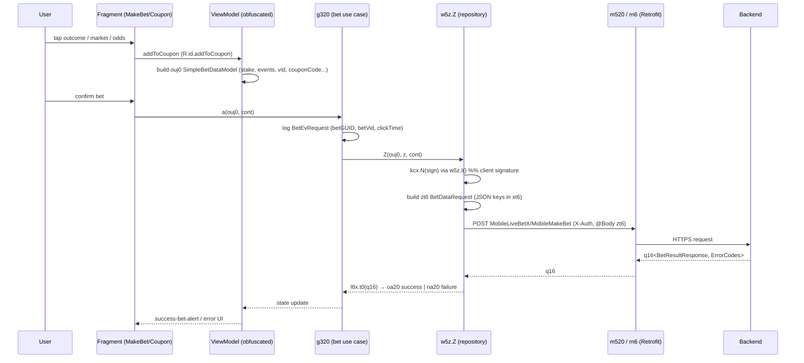
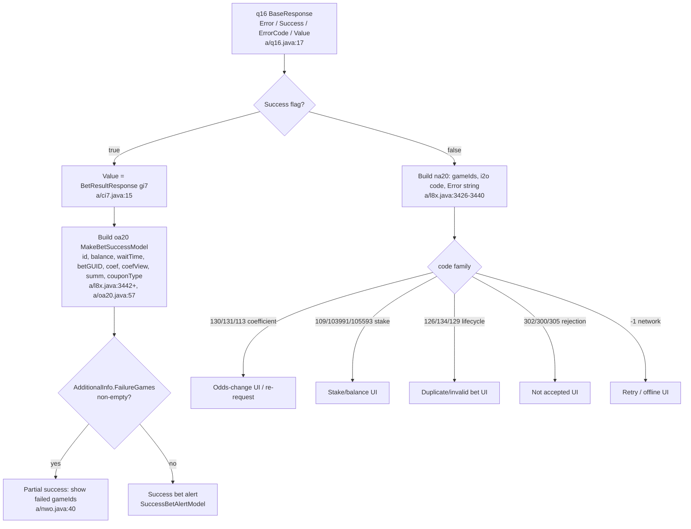

# 1xBet Android — Complete Betting Lifecycle (Static Reverse-Engineering)

**Target:** `D:\1xbetrea\1xbet.apk` — `org.xbet.client1`, version `1xbet-prod-v260.1.0` (sha256 not re-verified here; APK is 47,715,154 bytes).
**Sources:** JADX Java output at `D:\1xbetrea\decompiled\sources` (69,001 files); `apktool_out`; REA JADX-provider MCP tools (available, used only to confirm tool signatures — all citations below are to the on-disk decompiled sources).
**Scope:** Authorized static analysis of shipped artifacts only. No network action against production services. No real deposits/bets/withdrawals.
**Date:** 2026-11-24.

---

## 0. How to read this report (obfuscation context)

The first-party Kotlin code is **almost entirely obfuscated** into a single flat package `a` (64,225 of ~69k Java files). JADX preserved the obfuscated identifiers (`a.zt6`, `a.w5z`, `a.g320`, …), but **Kotlin `@Metadata` annotations survive** and contain original fully-qualified names in their `d2` arrays and in generated `kotlinx.serialization` descriptors (`new zna0("org.xplatform....")`). These descriptors are the primary evidence for original model names and exact JSON keys.

**Decoded Retrofit annotation map (Strongly Supported — derived from parameter usage, not a vendored source file):**

| Obfuscated | Original Retrofit meaning | Evidence |
|---|---|---|
| `@ofr("path")` | `@GET("path")` | `a/gir0.java:8-18` (used with `@nkd0` query params, no body) |
| `@kg80("path")` | `@POST("path")` | `a/m520.java:9-25`, `a/rn6.java:11-20` (always paired with `@jb8` body) |
| `@jb8` | `@Body` | `a/m520.java:10`, `a/gir0.java:22` |
| `@xpv("X-Auth")` | `@Header("X-Auth")` | `a/m520.java:10`, `a/gir0.java:22` |
| `@dtv({"..."})` | `@Headers({...})` | `a/hon.java:12`, `a/gir0.java:8` |
| `@nkd0("name")` | `@Query("name")` | `a/rn6.java:14-16`, `a/hon.java:13` |
| `@okd0` | `@QueryMap` | `a/hon.java:10`, `a/vre.java:12` |
| `@z190("BetType")` | `@Path("BetType")` | `a/hon.java:10`, `a/mf6.java:10-16` |
| `dx5<T>` | Xenvelop response envelope wrapper (`Accept: application/vnd.xenvelop+json`) | `a/gir0.java:8-9`, `a/hon.java:12-13` |
| `q16<T,Z>` | `org.xplatform.onexcore.data.model.BaseResponse` | `a/q16.java:17-22` |
| `i2o` | `org.xplatform...ErrorCodes` enum (implements `kuw`) | `a/i2o.java:7-8` |
| `yje<T>` | Kotlin coroutine `Continuation<T>` | ubiquitous in suspend API interfaces |

**Confidence legend:** **Confirmed** = directly readable in shipped bytecode/JADX; **Strongly Supported** = unambiguous reconstruction from metadata/descriptor; **Probable** = inferred from circumstantial evidence; **Unverified** = not provable from static artifacts.

---

## 1. Bet construction and submission — call sequence

### 1.1 UI entry points (Confirmed / Strongly Supported)

`org\xplatform` preserved fragment/screen stubs show the navigation surface:

- `org\xplatform\coupon\impl\coupon\presentation\CouponScreen.java` — `FragmentScreen` for the bet slip; the actual fragment is obfuscated `a/axe.java`, whose reflection metadata binds `org.xplatform.coupon.impl.databinding.FragmentCouponBinding` and args `couponId: String`, `afterBet: Boolean` (`a/axe.java:50`).
- `org\xplatform\make_bet\impl\presentation\model\CoefUiModel.java` — per-outcome coefficient UI model: `currentCoefView`, `currentCoefValue: Double`, `oldCoefView`, `coefChangeType`, `hasAutoSub` (fields `f46772a..i`, `toString()` at lines ~70-80). This is where a coefficient change is rendered.
- `org\xplatform\make_bet\impl\presentation\model\BetDetailsUiModel.java` — `betName`, `teamsName`, `subGameText`, `isDuelGame`, `hasAutoSub`.
- `a/a720.java:34` and `a/b720.java:27` bind `MakeBetBottomsheetFragmentBinding` / `MakeBetSimpleFragmentBinding` and carry `simpleBetGame: org.xplatform.betting.core.coupon.models.SingleBetGame` + `entryPointType`.
- Odds selection event names in decompiled metadata: `addToCoupon` (`org\xbet\client1\R.java:10835`, used at `a/lgj.java:31-32`), `ShowEventsAddedToCoupon` (`a/sgj.java:18`), and `BetZip` field `addedToCoupon` (`org\xplatform\betting\core\zip\model\zip\BetZip.java:159`).

### 1.2 Domain request object before transport (Confirmed)

`a/ouj0.java` — original name from `toString()` line 134: **`SimpleBetDataModel`** (domain-level bet request). Fields (`ouj0.java:11-68`):

```
balanceId, bonusId, betSum(String), advancedBet, betEventsModelList(List),
vid(int), checkCF(int), withLobby, eventsIndexes(List), groupSumms(List),
expressNum(long), coefViewTypeId(int), vipBetSum, approvedBet, promoCode,
betGuid, autoBetParamsModel(ex4), couponCode,
couponTypeModel(q4f), isExpressBoost, oneClick, isPowerBet(Boolean),
saleBetId, antiExpressCoef(double), builderCoupon(vb9)
```

`a/ouj0.java:71-104` provides a `copy`-style method `a(ouj0, String)` that replaces `betGuid` — used for retry with a corrected bet GUID.

### 1.3 Transport model and signature (Confirmed)

`a/zt6.java` — original name from serializer `a/xt6.java:17`: **`org.xplatform.betting.core.make_bet.data.model.BetDataRequest`**. Its `toString()` (`zt6.java:133-159`) names all 34 fields.

Exact JSON keys from the generated serializer `a/xt6.java:17-52` (this is the **actual wire body**; Confirmed):

| # | JSON key | Kotlin field | Type | Notes |
|---|---|---|---|---|
|0|`UserId`|f44940a|long|balance/account id|
|1|`UserIdBonus`|b|long|bonus account id|
|2|`AppGuid`|c|String|app GUID|
|3|`Summ`|d|String|**stake sent as String** (decimal precision) |
|4|`avanceBet`|e|boolean|advance bet flag|
|5|`Events`|f|List|`BetEventResponse` items (see §2)|
|6|`Vid`|g|int|bet source / coupon type (mapped by `a/nwd.java:13-69`)|
|7|`CheckCf`|h|int|coefficient-check mode|
|8|`WithLobby`|i|boolean| |
|9|`EventsIndexes`|j|List| |
|10|`GroupsSumms`|k|List|group stakes (system bets)|
|11|`expressNum`|l|long| |
|12|`partner`|m|int|hard-coded to `1` in secondary ctor (`zt6.java:181`)|
|13|`CfView`|n|int|coefficient view type|
|14|`notWait`|o|boolean|hard-coded `true` (`zt6.java:183`)|
|15|`VIPBetSumm`|p|boolean| |
|16|`Source`|q|int|hard-coded `22` (`zt6.java:185`)|
|17|`Date`|r|String| |
|18|`Sign`|s|String|client signature|
|19|`Lng`|t|String|language|
|20|`ApprovedBet`|u|boolean| |
|21|`betGUID`|v|String|nullable|
|22|`promo`|w|String|nullable|
|23|`autoBetCf`|x|double| |
|24|`DropOnScoreChange`|y|boolean| |
|25|`TransformEventKind`|z|boolean| (line-to-live)|
|26|`CalcSystemsMin`|A|boolean| |
|27|`CouponCode`|B|String| |
|28|`IsExpressBoost`|C|boolean| |
|29|`OneClickBet`|D|int|quick bet flag|
|30|`IsPowerBet`|E|boolean| |
|31|`SaleBetId`|F|String|nullable (bet sale)|
|32|`specialTypes`|G|int| |
|33|`BuilderCoupon`|H|`yb9`|nullable bet-constructor coupon|

**Client-side signature** — `a/w5z.java:314-339` `static String l(ouj0, long)`:

```java
String events = CollectionsKt.b0(ouj0.e, "##", ..., new r520((byte)5), 30); // join events with "##"
int checkCf = (vid == q4f.m.a()) ? 0 : ouj0.g;
String reversed = new StringBuilder(String.valueOf(j)).reverse().toString();
StringBuilder sb = new StringBuilder(events)
    .append('_').append(ouj0.b)   // bonusId
    .append('_'); ... append(checkCf).append('_').append(cfView).append('_')
    .append(reversed);            // reversed timestamp
return kcx.N(sb.toString());      // digest
```

`a/kcx.java:288-309` `N(String)` uses `MessageDigest.getInstance(DigestServerAuthenticationHelper.DEFAULT_ALGORITHM)` with UTF-8 bytes and lowercase hex output. The referenced constant is a SHA-family algorithm from the bundled `android.gov.nist` core library; the exact SHA variant is **Probable (SHA-1)** — the constant's value was not inlined/read in this pass. This `Sign` is a **client-side anti-tamper value** whose verification is server-side (server-authoritative validation).

### 1.4 Submission call chain (Confirmed)

```
UI: outcome tap → addToCoupon (R.id.addToCoupon, a/lgj.java:31) → Build SimpleBetDataModel (a/ouj0)
  → a/g320.a(ouj0, zje)                      [bet-placement use case]   a/g320.java:27-90
      ├─ logs analytics "BetEvRequest"/"BetEvResponse"                 a/g320.java:46-59,77-88
      │  fields: betUniqueToken, betQuickBet, betClickTime, betGUID, betVid, betCouponId
      └─ w5z.Z(ouj0, zContains, cont)                                  a/w5z.java:2026-2059
          └─ qjj.d0(dispatcher, ys8lambda, cont)  (withContext)         a/w5z.java:2044-2047
              └─ ys8 (case 19) → build zt6 (BetDataRequest) + REST POST
                 → returns q16<BetResultResponse,ErrorCodes>
          └─ l8x.t0(q16) → MakeBetSuccessModel (oa20) or failure (na20) a/l8x.java:3400-3480
```

`a/g320.java:60-63` calls `q3d.j(...).contains(ouj0.s)` to branch on `couponTypeModel` (`q4f`), passing a boolean `z` into `w5z.Z` — i.e. the use case distinguishes certain coupon types (anti-express/express) when selecting the transport path.

**Confidence:** chain Confirmed for method bodies present; the specific `ys8` case-19 body is partly truncated by JADX (`a/ys8.java:1134-1152` shows a JADX `IfRegionVisitor` failure), so the exact `zt6` construction inside the lambda is **Strongly Supported** rather than fully readable.

---

## 2. Bet-slip / coupon generation and validation

### 2.1 Coupon type taxonomy (Confirmed)

`a/q4f.java:35-80+` (`CouponTypeModel`) enum constants and numeric ids used by `a/nwd.java:13-69` (`Vid` mapping):

`UNKNOWN(0)`, `SINGLE(1)`, `EXPRESS(2)`, `SYSTEM(3)`, `CEPOCHKA(4)`, `MULTI_BET(5)`, `CONDITION_BET(6)`, `ANTIEXPRESS(7)`, `LUCKY(8)`, `PATENT(9)`, `BET_BUILDER(10)`, `MULTI_SINGLE(11)`, `TOTO_FOOT(12)`, `TOTO_SCORE(13)`, `TOTO_HOCKEY(14)`, `TOTO_FIFTEEN(15)`, `TOTO_CYBER_FOOT(16)`, `TOTO_CYBER_SPORT(17)`, `TOTO_BASKET(18)`, `TOTO_1X(19)`, … (more TOTO types follow). `nwd.b(int)` divides by 10000 for large ids (multi-region coupon ids).

### 2.2 Per-selection model (Confirmed — exact JSON keys)

`a/jv6.java:16-51` serializer for **`org.xplatform.betting.core.make_bet.data.model.BetEventResponse`** — this is each item in the `Events` array of `BetDataRequest` and of `UpdateCouponRequest`:

`Coef`, `CV`, `PV`, `Param`, `ParamMobile`, `Type`, `UiFeature`, `GameId`, `Kind`, `PlayerId`, `Block`, `Seconds`, `Expired`, `Price`, `InstrumentId`, `IsRelation`, `IsBannedExpress`, `FullScore`, `PeriodScores`, `ExtraKind`, `MS1`, `MS2`, `FS1`, `FS2`, `PS`, `SpecialCoef`, `TimeSec`, `TimeDirection`, `OriginalPlayerId`, `FullName`, `Finish`, `GameConstId`, `OptionLowerCf`, `OptionLowerCfView`.

Sanitized example (field names from code, values illustrative):
```json
{"GameId":1234567,"Type":12,"Kind":3,"Param":42,"CV":1.85,"PV":"1.85",
 "Coef":1.85,"Block":false,"Expired":false,"IsBannedExpress":false,
 "InstrumentId":0,"TimeSec":0,"Finish":false}
```

Note the app sends both **numeric `Coef`/`CV`** and **string `PV` (coefficient view)** — consistent with server recalculating and returning `Coef`/`CoefView` in `CouponResponse`.

### 2.3 Coupon generate / save / update endpoints (Confirmed)

`a/vre.java` (coupon API interface):

| Method | Endpoint | Body type | Response |
|---|---|---|---|
|`a/vre.java:11-12`|`GET MainFeedLine/mobile/v3/betsOnFavoriteEvents`|query map|`dx5<List<zg7>>`|
|`a/vre.java:15-16`|`GET MainFeedLive/mobile/v3/gamesForCoupon`|`gameIds`,`lng`,`whence`|`dx5<List<s5t>>`|
|`a/vre.java:18-19`|`POST MobileLiveBetX/MobileSaveCoupon`|`xxg0`|`q16<String, i2o>`|
|`a/vre.java:21-22`|`POST MobileLiveBetX/MobileUpdateCouponMulti`|`fit0`|`q16<List<oit0>, i2o>`|
|`a/vre.java:24-25`|`POST MobileLiveBetX/MobileSaveCoupon`|`byg0`|`q16<String, i2o>`|
|`a/vre.java:27-28`|`POST MobileLiveBetX/MobileUpdateCoupon`|`iit0`|`q16<oit0, i2o>`|
|`a/vre.java:30-31`|`GET MobileLiveBetX/GetBets`|query map|`List<q16<fm00, i2o>>`|
|`a/vre.java:37-38`|`POST MobileLiveBetX/MobileUpdateCouponBuilder`|`sht0`|`q16<wht0, i2o>`|
|`a/wl00.java:8-12`|`POST MobileLiveBetX/MobileGetCoupon`|`dn00`/`an00`|`q16<fm00, i2o>`|

`a/git0.java:16-41` serializer for **`UpdateCouponRequest`** JSON keys:
`UserId, UserIdBonus, AppGuid, Vid, expressNum, Summ, Source, partner, CheckCf, Lng, notWait, Events, CfView, avanceBet, SaleBetId, MinBetSystem, AddPromoCodes, IsPowerBet, EventsIndexes, WithLobby, CalcSystemsMin, IsExpressBoost, Country, specialTypes`.

`a/mit0.java:19-75` serializer for **`UpdateCouponResponse`** JSON keys (truncated at 58, first 56 shown):
`BonusCode, CfView, CheckCf, Code, Events, ExpresCoef, Groups, GroupsSumms, Lng, NeedUpdateLine, Source, Sport, Summ, TerminalCode, Top, UserId, UserIdBonus, Vid, WithLobby, avanceBet, betGUID, changeCf, expressNum, notWait, partner, promo, InitialBet, BetStep, EventsIndexes, minBet, maxBet, MinBetSystems, lnC, lvC, Coef, CoefView, AntiExpressCoef, UnlimitedBet, RestrictionWarning, RestrictionWarningGameIds, MaxPayout, promoCodes, HyperBonusPercent, MinHyperBonusBetLimit, MaxHyperBonusLimit, exceptionText, NegAsiaBetFlg, CoefType, EventCountToBoost, MinEventCoefToBoost, IsExpressBoost, MinEventCountToBoost, NotValid, specialTypes, OptionLowerCf, OptionLowerCfView, …`

### 2.4 Client-side validation rules (Confirmed / Strongly Supported)

- **Stake bounds** — `StepInputUiModel` (`org\xplatform\make_bet\impl\presentation\model\StepInputUiModel.java:24-45`) fields: `currentValue`, `initValue`, `stepValue`, `minValue`, `maxValue`, `currencySymbol`, `isUnlimitedBet`, `hasInitValue`, `autoMaxModel`, `isEditEnabled`, `isActionButtonEnabled`, `isUserInput`, `isStepControlsVisible`, `isVipBet`, `isSavedStateModel`, `isLoading`, `isEachWay`. Default when absent (`a/fy4.java:139`, `a/h620.java:145`, `a/qg20.java:251`): `min=-1`, `step=1.0`, `max=-1`, `isUnlimitedBet=true` — i.e. **-1 is a sentinel meaning "server did not supply a bound"**. Real bounds arrive from `UpdateCouponResponse.minBet/maxBet/BetStep` and `Games/Feed/MinMax/ByAccount` (`a/luz.java:9`).
- **Coefficient bounds** — `CoefStepInputUiModel` uses `java.math.BigDecimal` for all five numeric fields (`org\xplatform\make_bet\impl\presentation\model\CoefStepInputUiModel.java:19-38`). Default (`a/fy4.java:135`, `a/h620.java:143`): step `0.1`, min coef `1.01`, max coef `999.999` (one variant `9999999999999.999`). This is a **client formatting/step guard** for "coefficient type" bets, not the authoritative odds.
- **Auto-max** — `AutoMaxUiModel(isAutoMaxEnabled, autoMaxValue)` (`org\xplatform\make_bet\impl\presentation\model\AutoMaxUiModel.java:16-24,50`) — server-driven maximum ("auto max" button).
- **No client-side acceptance of a bet** — the bet is only accepted after the server returns `q16.Success=true`; see §5.
- **Signature** — `w5z.l()` / `kcx.N()` (§1.3) is a client-generated integrity value; server validates.

**Missing / Unverified:** exact string-input formatting (decimal separator, grouping) is implemented in obfuscated UI helpers (`a/cw40`-style lambdas, `w5z` constructor with `BigDecimal`/`Locale` at `w5z.java:13-30`) and was not fully reconstructed. `MaxPayout` handling exists in `UpdateCouponResponse` but its enforcement path was not traced.

---

## 3. Odds retrieval, update, and stale-odds handling

### 3.1 Odds sources (Confirmed)

1. **Pre-match/live feed ZIP** — `a/hon.java:9-10`:
   ```java
   @ofr("{BetType}Feed/Mb_GetEventsZip")            // GET
   Object a(@z190("BetType") String lineLive, @okd0 Map<String,Object> params, yje<q16<i0t,i2o>> cb);
   ```
   `{BetType}` is substituted with `Line`/`Live` (same pattern in `a/hon.java:13`, `a/mf6.java:10/15`). Response `dx5<su10>` for the `MainFeed{BetType}/mobile/v3/game` variant (`hon.java:12-14`). Feed responses are wrapped in `dx5` with header `Accept: application/vnd.xenvelop+json`.
2. **Per-event / coupon game data** — `GET MainFeed{BetType}/mobile/v3/gamesForCoupon` (`a/vre.java:15-16,41-42`), `GET MainFeed{BetType}/mobile/v3/game` (`a/hon.java:13`).
3. **Bet builder** — `POST /MainFeed{BetType}/mobile/betbuilder/v3/events` (`a/mf6.java:10-12`), `GET /MainFeed{BetType}/mobile/betbuilder/v3/gameInfo` (`a/mf6.java:14-16`).
4. **Websocket real-time channel** — `a/ts4.java:469-477`:
   ```java
   Request.Builder builder = new Request.Builder();
   builder.d(str2.concat("/sockets/channel"));      // OkHttp .url(...)
   ...
   new c00(..., ft4Var.b.b)                          // Flow/observable of socket events
   ```
   Managed by `a/ft4.java` (holds `List<WebSocket>`), `a/guc.java` (OkHttpClient + `RealWebSocket` + endpoint strings `c,d,e`), `a/fuc.java` (extends `okhttp3.WebSocketListener`, parses `org.json.JSONObject`). **Probable** that this channel carries live coefficient ticks; the specific subscription frames/coefficient payload were not fully reconstructed (JADX truncation). No socket.io library is present — this is raw OkHttp WebSocket.
5. **Odds-type settings** — `org\xplatform\coef_type\impl\navigation\CoefTypeScreenFactoryImpl$getSettingsCoefTypeScreen$1.java` (screen only); server field `CoefType` in `UpdateCouponResponse` (`a/mit0.java:67`).

### 3.2 Stale odds between selection and confirmation (Confirmed)

The app does **not** silently accept changed odds; it re-requests a recalculated coupon and shows a change description:

- `a/eye.java:7-20` — `CouponInfoUiModel(mainContainerUiState, coefChangeDesc: String, optionBetUiState, isAutoSub: Boolean)`.
- `a/cye.java:7-22` — `CouponInfoUiModel(coefficientContainerState, coefChangeDesc, isAuthorized, autoSubUiModel, optionBetUiState)`.
- `a/dye.java:59-62` — same model with `whenCoefChangedTitle`, `coefTitle`.
- UI bindings: `R.id.tvCoefChangeDesc` (`org\xbet\client1\R.java:14956`; used in `a/r620.java:105-106`), and the "possible win changed" block `clPossibleWinChange`, `ivPossibleWinChange`, `tvPossibleWin`, `tvPossibleWinChange`, `tvPossibleWinNew`, `tvPossibleWinOld`, `tvPossibleWinValue` (`a/brb0.java:33-107`).
- `CoefUiModel` carries `currentCoefValue`/`oldCoefView`/`coefChangeType` and `BetDetailsUiModel.hasAutoSub` — i.e. the UI distinguishes old vs new coefficient and whether auto-substitution (auto-accept) is enabled.
- **Re-request endpoint:** `POST MobileLiveBetX/MobileUpdateCoupon` (`a/vre.java:27-28`) with `UpdateCouponRequest` carrying `CheckCf` and the selected `Events`; response `UpdateCouponResponse` contains `changeCf`, `NeedUpdateLine`, updated `Events`, new `Coef`/`CoefView`/`ExpresCoef`, `NotValid`, `minBet/maxBet`, `MaxPayout`, `RestrictionWarning*`. Multi-coupon variant `MobileUpdateCouponMulti` (`a/vre.java:21-22`), builder variant `MobileUpdateCouponBuilder` (`a/vre.java:37-38`).
- **Server rejection if odds changed at submit time:** `i2o.CoefficientChangeCode("130")`, `CoefficientBlockCode("131")`, `CoefficientTemporarilyBlocked("113")`, `WrongCoefficient("159142")`, `WrongBetCoefficient("105643")`, `EventParameterChanged("148")`, `GameScoreIsChanged("157094")`, `PriceIsChangedForFinancialInstrument("301")` (`a/i2o.java:27-28,113,131,158,190,200,223`).
- `BetDataRequest.CheckCf` (`xt6.java:25`) and `CouponCode`/`betGUID` are the mechanisms tying a bet to a quoted coefficient; `ouj0.a(ouj0, String)` (`a/ouj0.java:71-104`) can replace `betGuid` for a corrected retry.

**Interpretation (Strongly Supported):** selection → local coupon shows coefficient → if feed/socket or `MobileUpdateCoupon` reports a change, the UI updates `coefChangeDesc` + old/new coef + old/new possible win, and (if `isAutoSub`) proceeds with the new coefficient; otherwise it asks the user. At submit, the server re-validates the coefficient and rejects with code 130/131/113 if stale. The exact user-prompt decision tree is obfuscated and not fully reconstructed.

---

## 4. Stake validation and potential winnings

### 4.1 Stake (Confirmed for model/API; Probable for UI mechanics)

- Stake is transmitted as **string `Summ`** (`a/xt6.java:21`, `a/zt6.java:25`) — chosen to avoid floating-point rounding in JSON.
- Bounds/limits are **server-authoritative**: `UpdateCouponResponse.minBet`, `maxBet`, `BetStep`, `MaxPayout`, `UnlimitedBet`, `MinBetSystems`, `HyperBonus*` (`a/mit0.java:49-64`); separate `Games/Feed/MinMax/ByAccount` (`a/luz.java:9`). `StepInputUiModel.min/max` are populated from these; `-1` is "unlimited/unset" sentinel.
- Server error codes for stake: `BetSumExceeded("103991")`, `BetSumExceededNew("109")`, `AmountLessMinRate("105593")`, `NotCorrectBetSum("12202")`, `IncorrectBetSum("102767")`, `WrongSumOfBet("105639")`, `WrongRestOfBalanceAfterBet("157311")`, `ExceededMaxAmountBets("105571")`, `MinSummForVIP("156531")` (`a/i2o.java:31-32,44,58,133,182,176,55,152`).
- Balance check is also server-side; response returns new `Balance` (`a/ci7.java:17`, mapping to `gi7.b` / `MakeBetSuccessModel.balance`).

### 4.2 Potential winnings (Strongly Supported: server-computed; client formats)

- `UpdateCouponResponse` supplies `Coef`, `CoefView`, `ExpresCoef`, `Summ`, `MaxPayout` (`a/mit0.java:25,32,54-55,60`) — the **server returns the recalculated coupon coefficient and stake**, so the authoritative "possible win" is derived from server data.
- `BetResultResponse`/`CouponResponse` likewise returns `Coef`, `CoefView`, `Summ` after acceptance (`a/h1f.java:17-19`, `a/ci7.java:21`). `MakeBetSuccessModel` exposes `coef`, `coefView`, `summ` (`a/oa20.java:57-71`).
- Client-side display models: `a/be20.java:26-27` `Value(possibleWin=…)` wrapping `ank0` (a `SpannableString` builder, `a/ank0.java:23-45`); `a/btn0.java:117-131` `SwipexCardMultiTeamUiModel(... coef=Coef(value=…), possibleWin=PossibleWin(value=…))`; `a/bhf.java:86-99` `CrystalResponse(… coeff=…, winSum=…)`. Formatting helpers include `h8x.s(ctf0Var, double, String)` (e.g. `a/ko0.java:811`, `a/wx4.java:111`).
- **Conclusion:** coefficient and stake (hence winnings) are **backend-authoritative**; the client multiplies/formats only for the live preview while the user types. I did **not** isolate a single clean `stake × coef` multiplication statement — the preview arithmetic is distributed across obfuscated formatting helpers (`h8x.s/u`, `ank0`, `w5z.R` at `a/w5z.java:1057-1337`). Confidence in "client preview exists" = Probable; in "backend is authoritative" = Confirmed.
- **Precision handling:** `CoefStepInputUiModel` uses `BigDecimal` (`org\xplatform\make_bet\impl\presentation\model\CoefStepInputUiModel.java:19-38`), stake uses `String`, coefficient uses `Double` in transport models (`BetDataRequest.autoBetCf: double`, `BetEventResponse.Coef`), and `MakeBetSuccessModel` uses `double`. Mixed precision is deliberate: money as string/BigDecimal, odds as Double.

---

## 5. Bet request transmission and response handling

### 5.1 Complete endpoint inventory (all Confirmed — literal strings in `a/*.java`)

**Sports betting (core):**
| Endpoint | Method | File:line |
|---|---|---|
|`MobileLiveBetX/MobileMakeBet`|POST|`a/m520.java:9-10`|
|`MobileLiveBetX/MobileMakeBetMulti`|POST|`a/m520.java:18-19`|
|`MobileLiveBetX/MobileMakeBetBid`|POST|`a/m520.java:21-22`|
|`MobileLiveBetX/MobileMakeBetBuilder`|POST|`a/m520.java:24-25`|
|`MobileLiveBetX/MobileGetAvanceX`|POST|`a/m520.java:12-13`|
|`MobileLiveBetX/SaveBets`|POST|`a/m520.java:15-16`|
|`MobileLiveBetX/MobileMakeBetAlternative`|POST|`a/rn6.java:11-12`|
|`MobileLiveBetX/MobileMaxBetAlternative`|POST|`a/n520.java:9-10`|
|`MobileLiveBetX/MobileSaveCoupon`|POST|`a/vre.java:18-19,24-25`|
|`MobileLiveBetX/MobileUpdateCoupon`|POST|`a/vre.java:27-28`|
|`MobileLiveBetX/MobileUpdateCouponMulti`|POST|`a/vre.java:21-22`|
|`MobileLiveBetX/MobileUpdateCouponBuilder`|POST|`a/vre.java:37-38`|
|`MobileLiveBetX/MobileGetCoupon`|POST|`a/wl00.java:8-12`|
|`MobileLiveBetX/GetBets`|GET|`a/vre.java:30-31`|
|`MobileLiveBetX/MobileCancelBetBidWeb`|POST|`a/hv4.java:11`, `a/sw4.java:11`|
|`/MobileLiveBetX/MobileSaleBetSumExtS`|POST|`a/nvg0.java:8` (bet sale/cashout)|
|`/MobileLiveBetX/ExpressHighlight`|POST|`a/s07.java:8`|
|`alterbuilder/v3/calcEventGroups`|POST|`a/rn6.java:14-20` (bet constructor)|
|`Games/Feed/MinMax/ByAccount`|POST|`a/luz.java:9`|
|`PDFGeneratorService/GetPDFCouponForMobileWithHeaders`|POST|`a/mj0.java:12`, `a/omj0.java:9`|
|`PDFCuponGeneratorService/GetPromoPNGCouponForMobile`|POST|`a/mj0.java:9`|
|`BetHistory/Mobile/GetBetInfoHistoryWithSummaryByDates`|POST|`a/r37.java:9`, `a/oj7.java:11`|
|`BetHistory/Mobile/GetBetInfoHistoryByBetIdScan`|POST|`a/r37.java:21`|
|`BetHistory/Mobile/GetBetEventAlternativeInfos`|POST|`a/no2.java:8`|
|`BetStorage/GetHistoryBetMobile`|POST|`a/r37.java:18` (line 18 of r37)|
|`promocode/UsePromocode`|POST|`a/p9c0.java:10`|

**Toto / jackpot (separate vertical):** `POST /toto2/Mobile/v1/makeBet` (`a/gir0.java:20-22`, body `zkr0` = `TotoBetRequest`, header `X-Auth`), `POST /toto/JackpotMobile/v1/makeBet` (`a/nqr0.java:20`), `GET /toto2/Mobile/v1/couponInfo` (`a/wb7.java:8`), `GET /toto2/Mobile/v1/activeTirag` (`a/gir0.java:17-18`).

**Headers/signing:** `X-Auth` token header on every authenticated bet POST (`a/m520.java:10`, `a/rn6.java:12`, `a/gir0.java:22`, `a/n520.java:10`). Feed endpoints use `Accept: application/vnd.xenvelop+json` (`a/hon.java:12`, `a/vre.java:10`, `a/mf6.java:11`). Body integrity is the `Sign` field (§1.3). **Unverified:** whether additional device/app headers (fingerprint, `X-Request-Id`) are injected by an OkHttp interceptor — not traced in this pass.

### 5.2 Response envelope (Confirmed)

`a/q16.java:7-22` = `org.xplatform.onexcore.data.model.BaseResponse<T,Z>` with JSON keys `Error`(String), `Success`(boolean), `ErrorCode`(enum), `Value`(T). `q16.a()` (`a/q16.java:43-58`) throws `zhi0` when `Error` is non-empty:

```java
public final Object a() throws zhi0 {
    if (Error != null && Error.length() > 0) throw new zhi0(Error, errorCode, null, 12);
    Object v = this.d; if (v == null) { return null; }
    return this.b ? v : null;      // Success flag gates Value
}
```

### 5.3 Success / rejected / pending / cancelled (Confirmed mapping)

`a/l8x.java:3400-3480` `t0(q16)` converts the envelope to UI results:

- **Success** (`q16.Success=true`): builds `oa20` **`MakeBetSuccessModel`** (`a/oa20.java:56-73`) from `gi7`:
  ```
  MakeBetSuccessModel(id=<Coupon.Id>, balance=<Balance>, waitTime=<WaitTime>,
    betGUID=<betGUID>, walletId=<Coupon.UserIdBonus>, coef=<Coupon.Coef>,
    coefView=<Coupon.CoefView>, lnC, lvC, summ=<Coupon.Summ>,
    couponTypeModel=<nwd.b(Coupon.Vid)>, eventModels=[...])
  ```
  `BetResultResponse` JSON keys (`a/ci7.java:15-24`): `AdditionalInfo`, `Balance`, `Id`, `betGUID`, `WaitTime`, `Coupon`, `lnC`, `lvC`. `AdditionalInfo` is `FailureGamesResponse(gameIds)` (`a/nwo.java:39-41`, serializer `a/lwo.java`) — i.e. **partial success** is reported by a list of failed game ids inside an otherwise successful response.
- **Rejected** (`q16.Success=false`): builds `na20` with `(gameIds from AdditionalInfo, i2o error code, Error string)` (`a/l8x.java:3426-3440`). Analytics logs `BetEvResponse` with `betCouponId` only on success (`a/g320.java:76-88`).
- **Pending:** `WaitTime` on success (`ci7.java:20`, `oa20.waitTime`) plus `notWait` request flag (`xt6.java:32`) imply asynchronous acceptance: the app may show "bet accepted, waiting" and later poll `BetHistory`/`GetBets`. The exact polling state machine is **Probable/Unverified**.
- **Cancelled / blocked:** expressed as error codes, not a distinct envelope: `BetIsNotAccepted("302")`, `BetIsNotAcceptedForFinancialInstrument("300")`, `BetsAreNotAcceptedForOneExpress("305")`, `FailedCompleteBet("104")`, `GameLocked("133")`, `Locked("135")`, `BetsBlocked("111003")`, `BetEventBlocked("111004")`, `GameIsClosed("149")`, `UserMustNotMakeBets("152")` (`a/i2o.java:64-65,157,133,159,29-30,168,174`).
- **Success-bet alert model:** `org\xplatform\betting\core\success_bet_alert\presentation\models\SuccessBetAlertModel.java:17-28` carries `(String, String, String, Long, String, List)`; `SuccessBetInfoItem` sealed interface with `Simple`/`WithCurrency` (`SuccessBetInfoItem.java:11-22`); `SuccessBetStringModel.java:15-25` carries 4 strings. These are presentation models fed from `MakeBetSuccessModel`.

### 5.4 Error code catalog (excerpt — Full enum at `a/i2o.java:8-226`)

Coefficient/odds: `130 CoefficientChangeCode`, `131 CoefficientBlockCode`, `113 CoefficientTemporarilyBlocked`, `159142 WrongCoefficient`, `105643 WrongBetCoefficient`, `148 EventParameterChanged`, `157094 GameScoreIsChanged`.
Stake/balance: `109/103991 BetSumExceeded`, `105593 AmountLessMinRate`, `12202 NotCorrectBetSum`, `157311 WrongRestOfBalanceAfterBet`.
Coupon/express/system: `308 WrongEventsInExpress`, `168 ExperssEventLimit`, `106407 WrongSystemParams`, `104645 BetsAreLimited`, `159426 BetsLimitIsExceeded`, `157972 EventsMaxCountExceeded`, `102677 WrongCouponFormat`.
Duplicate/lifecycle: `126 AlreadyBet`, `134 BetAlreadyPlaced`, `158218 BetExistsError`, `127 UserAlreadyBetOnOutcomeGame`, `129 WrongGameBet`, `141 GameIsNotExist`, `100/142 Live/LineGameFinished`, `158151 GameIsNotInLine`.
Bonus: `111005 ForbiddenBonusBet`, `159075 BetDoesNotMatchToBonus`, `105707 BonusIsClosed`, `105637 TypeOfBetDoesNotMatchToBonus`.
Bet sale: `643 BetSaleUnknownError`, `165497 BetAlreadySaved`, `165498 BetFromAnotherUser`.
Network/HTTP: `-1 NoInternetConnection`, `400/403/404/429/500`, `99 Error`, `158225 UnknownError`.

---

## 6. Client-side vs server-authoritative

| Aspect | Authority | Evidence |
|---|---|---|
| Selection → `BetEventResponse` fields sent | Client assembles, server validates | `jv6.java`, `xt6.java` |
| Stake bounds (min/max/step), balance, payout cap | **Server** | `mit0.java:49-60`, `luz.java:9`, `i2o.java:31,58` |
| Coefficient values & recalculation | **Server** | `mit0.java:25,54-55`, `h1f.java:17-18`, `i2o.java:27,113,131` |
| Final win/payout | **Server** (client formats preview) | `ci7.java`, `h1f.java`, `oa20.java` |
| Bet acceptance / rejection codes | **Server** | `q16.java`, `i2o.java`, `l8x.java:3426-3440` |
| Bet GUID / coupon id / WaitTime | **Server** | `ci7.java:18-20`, `oa20.java:57-71` |
| Request `Sign` digest | Client computes; server verifies | `w5z.java:314-339`, `kcx.java:288-309` |
| Odds display formatting / step controls / auto-sub UI | Client | `CoefUiModel`, `StepInputUiModel`, `eye.java` |
| Coupon type mapping | Client maps id→enum, server supplies `Vid` | `nwd.java:13-69`, `q4f.java` |

---

## 7. Interesting logic / features

- **Express / accumulator & system bets** — `q4f.EXPRESS(2)`, `SYSTEM(3)`, `CEPOCHKA(4)`, `ANTIEXPRESS(7)`, `PATENT(9)`, `MULTI_SINGLE(11)`. `BetDataRequest.expressNum`, `GroupsSumms`, `CalcSystemsMin` (`xt6.java:28-29,44`); `BetSystemRequest` wire keys `b,c,p,s` (`a/gn7.java:13-18`; `s` = system-params list). `POST MobileLiveBetX/ExpressHighlight` (`a/s07.java:8`); day-express screen `org\xplatform\feature\dayexpress\impl\presentation\DayExpressScreen.java`.
- **Bet constructor / builder** — `org\xplatform\bet_constructor\impl\...` modules; `MakeBetViaConstructorRequest` serializer `a/wg20.java` (17 fields); `BuilderEventRequest`/`BuilderGameRequest`/`BuilderCouponRequest` (`a/cc9.java`, `a/fc9.java`, `a/wb9.java`); `POST alterbuilder/v3/calcEventGroups` (`a/rn6.java:14-20`); `POST MobileLiveBetX/MobileMakeBetBuilder` (`a/m520.java:24-25`), `MobileUpdateCouponBuilder` (`a/vre.java:37-38`). `StepInputConfigModel` in `org\xplatform\bet_constructor\impl\makebet\domain\model\StepInputConfigModel.java`.
- **Cashout / bet sale / edit coupon** — `POST /MobileLiveBetX/MobileSaleBetSumExtS` (`a/nvg0.java:8`); `org\xplatform\bet_history\bet_sale\presentation\BetSaleScreen.java`, `...\sale\presentation\SaleBetScreen.java`, `...\edit_coupon\presentation\EditCouponFragmentScreen.java`, `...\edit_event\presentation\EditEventFragmentScreen.java`; edit models `EditCouponRequest`/`Response` (`a/smn.java`, `a/vmn.java`), `EventResponse` (44 fields) (`a/ggo.java`). `BetSaleUnknownError("643")`.
- **Free bets / bonuses in betting** — `UserIdBonus`, `avanceBet`, `promo`, `VIPBetSumm`, `IsPowerBet`, `HyperBonus*` in request/response; `org\xplatform\makebet_promocodes\api\presentation\models\PromoCodeInfoUiModel.java`; `promocode/UsePromocode` (`a/p9c0.java:10`); error codes `ForbiddenBonusBet`, `BonusIsClosed`, `BetDoesNotMatchToBonus`.
- **Quick bet / one-click** — `OneClickBet` (`xt6.java:47`), `betQuickBet` analytics flag (`a/g320.java:48,79`), `oneClick` in `ouj0`.
- **Bet sharing / coupon PDF** — `org\xplatform\bethistory\share_coupon\presentation\ShareCouponScreen.java`, `ShareCouponRequest` serializers (`a/gnj0.java`, `a/hnj0.java`), PDF endpoints (`a/mj0.java:9-12`, `a/omj0.java:9`), `org\xplatform\coupon\impl\generate_coupon\...` (GenerateCouponsScreen, FindCouponRequest/Response `a/kht.java`, `a/hdq.java`).
- **Coupon notification worker** — `org\xplatform\coupon\impl\notify\CouponNotificationWorker.java` (CoroutineWorker) — likely notifies on bet result/coupon state.
- **Coupon scanner / history** — `org\xplatform\bethistory\coupon_scanner\presentation\CouponScannerScreen.java`, `CouponScannerRequest` (`a/f2f.java`), `GetBetInfoHistoryByBetIdScan` (`a/r37.java:21`).
- **Toto & financial bets** — separate verticals with their own `makeBet` endpoints (`a/gir0.java:20`, `a/nqr0.java:20`, `a/lbq.java` FinanceBetRequest `a/nbq.java`).
- **Bet-source analytics** — `a/q4f` + `a/nwd` mapping; `BetEvRequest`/`BetEvResponse` logging (`a/g320.java:46-88`, `a/wdu.java:990-1015`) with `betVid`, `betGUID`, `betCouponId`, `betClickTime`, `betUniqueToken`, `betQuickBet`.

---

## 8. Mermaid diagrams

### 8.1 Bet placement



### 8.2 Odds update / stale-odds recalculation

```mermaid
flowchart TD
    A[Feed: GET {BetType}Feed/Mb_GetEventsZip<br/>a/hon.java:9] --> B[Parse q16/i0t → events with Coef, CV, PV<br/>a/jv6.java:17-51]
    C[WebSocket {base}/sockets/channel<br/>a/ts4.java:469-477] --> B
    B --> D{odds differ from<br/>selected snapshot?}
    D -- no --> E[Coupon shows current coef]
    D -- yes --> F[POST MobileLiveBetX/MobileUpdateCoupon<br/>UpdateCouponRequest CheckCf + Events<br/>a/vre.java:27, a/git0.java:16]
    F --> G[UpdateCouponResponse: changeCf, NeedUpdateLine,<br/>new Coef/CoefView/ExpresCoef, minBet/maxBet,<br/>NotValid, RestrictionWarning — a/mit0.java:19]
    G --> H[CouponInfoUiModel: coefChangeDesc, isAutoSub<br/>a/eye.java, a/cye.java]
    H --> I{isAutoSub?}
    I -- yes --> J[Accept new coef, update possibleWin<br/>tvPossibleWinNew/Old — a/brb0.java:100-107]
    I -- no --> K[Prompt user (coefChangeDesc / tvCoefChangeDesc)]
    J --> L[Submit with new coefficient]
    K --> L
    L --> M{Server re-check at submit}
    M -- stale --> N[Error 130/131/113/159142<br/>a/i2o.java:27,113,131]
    M -- ok --> O[Success — MakeBetSuccessModel]
```

### 8.3 Response handling



---

## 9. What is missing and why

- **Exact `ys8` case-19 body** (the lambda that actually assembles `zt6` inside `w5z.Z`): JADX failed with `IfRegionVisitor`/SSA errors (`a/ys8.java:1134-1152`). The endpoint, models, and signature are Confirmed; the precise field-by-field assignment inside the lambda is not. REA `inspect_android_method` could recover smali if needed.
- **Websocket subscription frames / coefficient tick schema:** `a/ts4.java`/`a/guc.java`/`a/fuc.java` show the channel and listener but not the decoded payload; JADX obfuscation and JSON handling are generic. Reliance on the feed ZIP + `MobileUpdateCoupon` is therefore the better-proven path.
- **Digest algorithm name:** `DigestServerAuthenticationHelper.DEFAULT_ALGORITHM` constant value not read (SHA variant = Probable).
- **Potential-win multiplication statement:** distributed across obfuscated formatting helpers; only the authoritative fields and display models are Confirmed.
- **Request signing/encryption interceptor:** not traced; only the `Sign` body field and `X-Auth` header are Confirmed.
- **Backend behavior** (actual acceptance policy, pending-vs-accepted timing) is inherently **backend-dependent**; this report describes only what the client sends and how it parses responses.

---

## 10. Evidence index (top citations)

- API map: `a/m520.java:9-25`, `a/gir0.java:8-22`, `a/hon.java:9-14`, `a/vre.java:9-42`, `a/wl00.java:8-12`, `a/rn6.java:11-20`, `a/mf6.java:10-16`, `a/n520.java:9-10`, `a/luz.java:9`.
- Request model: `a/zt6.java:9-203`, `a/xt6.java:17-52`, `a/ouj0.java:11-104`, `a/w5z.java:314-339`, `a/kcx.java:288-309`.
- Response/error models: `a/q16.java:7-58`, `a/i2o.java:8-252`, `a/ci7.java:15-24`, `a/h1f.java:15-23`, `a/jv6.java:16-51`, `a/mit0.java:19-75`, `a/git0.java:16-41`, `a/nwo.java:39-41`, `a/oa20.java:56-73`, `a/l8x.java:3400-3480`, `a/g320.java:27-90`.
- Odds/stale: `a/eye.java:7-20`, `a/cye.java:7-22`, `a/dye.java:59-62`, `a/ts4.java:469-477`, `org\xplatform\make_bet\impl\presentation\model\CoefUiModel.java`, `org\xbet\client1\R.java:14956`, `a/r620.java:105-106`, `a/brb0.java:33-107`.
- Stake/winnings: `org\xplatform\make_bet\impl\presentation\model\StepInputUiModel.java:24-45,107-122`, `CoefStepInputUiModel.java:19-38`, `AutoMaxUiModel.java:16-24`, `a/be20.java:26-27`, `a/btn0.java:117-131`.
- Coupon types/features: `a/q4f.java:35-80`, `a/nwd.java:13-69`, `a/gn7.java:13-18`, `a/wg20.java`, `a/smn.java`, `a/vmn.java`, `a/mj0.java:9-12`.
