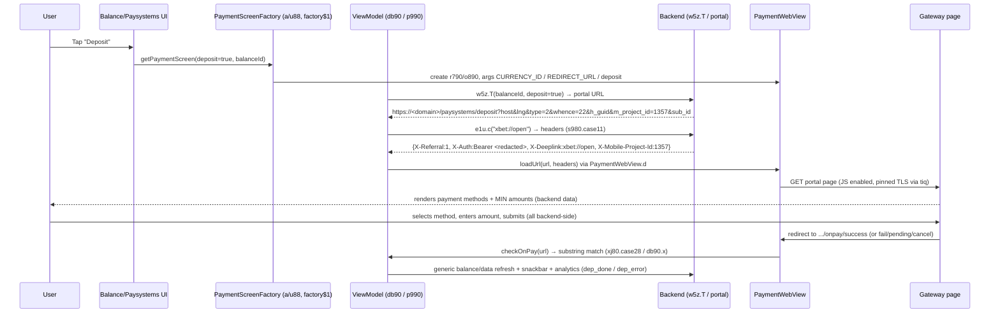

# 1xBet Android — Payment Architecture, Browser-Based Payments, Discrepancies & Dynamic Limits

**Target:** `D:\1xbetrea\1xbet.apk` — `org.xbet.client1`, `v1xbet-prod-v260.1.0`
**Method:** Static analysis only (JADX sources, apktool manifest/assets, smali). No network actions, no transactions.
**Artifacts:** `D:\1xbetrea\decompiled\sources` (69,001 files), `D:\1xbetrea\apktool_out`
**Date:** 2026-11-24

---

## Executive summary

| Question | Answer | Confidence |
|---|---|---|
| Where do payment methods & their min amounts live? | In **backend-rendered HTML**, loaded into an in-app `WebView` at `<domain>/paysystems/{deposit\|withdraw}?...`. There is **no native payment-method enum, no native min/max amount constant, and no local asset listing payment methods**. | **Confirmed** (code-level: URL builder + WebView; no native model found after targeted search) |
| What makes the minimum change on every refresh? | **Backend** decides it. Each refresh generates a *fresh* URL and re-issues the WebView request with session-bound headers (`X-Auth: Bearer …`, `X-Deeplink`, `h_guid`, `sub_id`). No client-side randomization or local fallback config exists. | **Strongly Supported** (client side proven; backend side unverified — backend dependency) |
| How is deposit/withdraw "success" determined? | By a **substring match on the WebView URL** (`/onpay/success`, `/onpay/fail`, `/onpay/pending`, `/onpay/cancel`, and `/onpay/withdraw/*`). No HMAC/signature validation of the callback. Backend remains authoritative for the actual ledger change. | **Confirmed** |
| Are amount discrepancies caused client-side? | **No client-side amount is sent for gateway deposits/withdrawals.** The app passes only currency/balance id + deposit flag; the amount is entered and submitted on the backend page. Internal wallet transfers use a `double` (`MoveMoneyRequest.transferAmount`) — a theoretical float-precision risk, but not the gateway path. | **Confirmed** (gateway path) / **Unverified** (root cause of user reports requires backend logs) |
| Deposit vs withdrawal limits independent? | Yes at the routing level (`/paysystems/deposit` vs `/paysystems/withdraw`); responsible-gaming limits are a separate backend service (`LimitService`). | **Strongly Supported** |

> **Bottom line for the primary objective:** the app is a *transport* for a backend payment portal. The changing minimums are almost certainly generated server-side per request (possibly keyed on session/geo/account/risk/A-B bucket). This cannot be proven further from the APK alone — the decisive evidence is in the backend HTTP response for the paysystems URL. Recommended next step (out of scope here): capture that response in an authorized test session and diff two refreshes with identical headers except `h_guid`/timing.

---

## Scope, evidence standards, and negative-search notes

Confidence labels: **Confirmed** (direct code), **Strongly Supported** (code + consistent absence of alternatives), **Probable** (inference), **Unverified** (needs backend/runtime).

Negative claims in this report are based on the following searches (all under `D:\1xbetrea\decompiled\sources`):
- `rg -i 'minamount|min_amount|min_sum|maxamount|minimal' -g '*.java'` → only `Integer.MIN_VALUE` noise, `R.string.min_amount/max_amount` resource IDs, and responsible-gaming `LimitService` models. No payment-provider min/max model.
- `rg -i 'webmoney|qiwi|skrill|neteller|bitcoin|tinkoff|kaspi|...' -g '*.java'` → no payment-system enumeration class; matches are unrelated obfuscated strings.
- `rg 'Random|nextInt|Math.random|SecureRandom|shuffle'` over `w5z.java`, `db90.java`, `n1.java`, `ze1.java` → **zero matches**.
- Native libs (`libkeys.so`, `libsecurity.so`, `libantifraud.so`, `libtoolChecker.so`) exist but were not required to explain the observed payment flow; encrypted assets (`assets/remote-config/remote-config.json` → `{"dataHex":"…"}`) cannot be read statically without their keys.

---

## A. Payment architecture

### A.1 Enumeration of payment methods — there is no native list

**Finding (Confirmed).** The app contains **no class that enumerates deposit/withdrawal payment systems** and no local JSON of payment methods. Instead:

1. The "Pay systems" screen is reached via deep link `xbet://open/paysystems?balanceId=…`.
   - `a\hrj.java:41` — enum constant `PAY_SYSTEMS("paysystems")`.
   - `a\erj.java:2806–2812` — deep-link router builds `vbd0(balanceId, registrationDefaultBonus)` from `paysystems` route (query params `balanceId`, `REGISTRATION_DEFAULT_BONUS_ID`).
   - `a\vbd0.java:6–34` — `PaySystem(balanceId, registrationDefaultBonus)` navigation model (no method list).
   - `org\xplatform\rules\impl\navigation\PaymentInfoScreenFactoryImpl$getPaymentInfoScreen$1.java:30–56` routes to a WebView fragment `a\x790` / `a\lmg0` with `EXTRA_URL`.

2. The URL for that screen is built at runtime in `a\w5z.java`, method `T(long balanceId, Continuation, boolean deposit)` — JADX left it as a bytecode dump at `a\w5z.java:1390–1400`; the equivalent smali is `apktool_out\smali_classes4\a\w5z.smali:8328–9310`. Reconstructed (sanitized):

   ```
   https://<runtime-domain>/paysystems/{deposit|withdraw}
       ?host=<host>
       &lng=<ISO language/country>
       &type=2
       &whence=22
       &h_guid=<app-install GUID>
       &m_project_id=1357
       &sub_id=<balanceId / currency id>
   ```
   Evidence lines (smali): path segments `paysystems` at `:8776`, `deposit`/`withdraw` at `:8791–8798`; query keys `host` `:9061`, `lng` `:9066`, `type=2` `:9071–9074`, `whence=22 (0x16)` `:9078–9085`, `h_guid` `:9089`, `m_project_id=1357 (0x54d)` `:9093–9102`, `sub_id=<balanceId>` `:9108–9114`; URL-encoding at `:9245–9285`.

   - Base domain `ujn.h` default: `a\ujn.java:22` → `"https://mob-experience.space"`, overwritten at app start from config: `a\p36.java:148–152`, `a\p36.java:192–196`, `a\bl50.java:59`, `a\to3.java:146`.
   - `h_guid` source: `a\knf0.java:24–34` (`FAKE_APP_GUID_ENABLED` override otherwise a persisted GUID); `lng` source: `knf0.c()` ISO code at `:46–48`; country id: `knf0.b()` at `:42–44`.

3. Payment *information* pages are also backend WebViews:
   - `a\okw.java:209` → `/paysystems/information/?type=2&whence=22&lng=<lang>&ref_id=1`
   - `a\j790.java:43` and `a\s690.java:44` → `/PaymentConsultant/office/payment/requests?set-base-url=v3-api&skip-lang-redirect=1`

**Conclusion (Confirmed):** the catalogue of deposit/withdrawal methods (cards, banks, e-wallets, crypto, local methods), their icons, and their displayed min/max amounts are **backend data**. The APK only provides the WebView container and request context. Any enumeration therefore requires the backend response, not the APK.

### A.2 End-to-end trace: UI action → API → URL → WebView → callback → status

**Navigation into the payment screen (Confirmed):**
- `a\u88.java:490–520`, `a\qv3.java:595`, `a\d7a0.java:394`, `a\g940.java:40`, `a\hbu0.java:44`, `a\oau0.java:30`, `a\qi4.java:191` construct `PaymentScreenFactoryImpl$getPaymentScreen$1(r990, boolean deposit, long balanceId)`.
- `org\xplatform\feature\office\payment\impl\di\navigation\PaymentScreenFactoryImpl$getPaymentScreen$1.java:31–62` chooses between two WebView-backed fragments behind a feature flag `ygp.e`:
  - **new:** `a\r790` (`compose_fragment`), args `CURRENCY_ID`, `REDIRECT_URL`, `deposit`, `NOTIFICATION_ID` (`r790.java:35, 50–53`),
  - **old:** `a\o890` (`fragment_payment_browser`), identical args (`o890.java:54, 68–71`).
- `getPaymentRedirectionScreen` variant passes an explicit redirect URL (`…$getPaymentRedirectionScreen$1.java:38–56`).

**URL acquisition (Confirmed, reconstructed from bytecode dumps):**
- `a\k790.java:6–40` — `PaymentContentParams(deposit, currencyId, redirectUrl)`.
- `a\db90.java:87–100` (new ViewModel) / `a\p990.java:81–83,130` (old ViewModel): if `redirectUrl` is empty, fetch it from backend using **balance/currency id + deposit flag**:
  - `a\n1.java:69–82` (bytecode dump) → `w5z.T(balanceId, cont, deposit)`; empty result → error state `ba90` (`n1.java:86–91`);
  - then `a\n1.java:93–105` builds the return URL from `deeplink_scheme` + `"://open"` → **`xbet://open`** (resource value confirmed: `apktool_out\res\values\strings.xml:1724`) and calls `e1u.c(returnUrl, …)` to obtain request headers;
  - emits `fa90` state with `(reloadEnable, k790, url, headers, balanceId, deposit, currentUrl, …)` — `a\n1.java:113–131`, model at `a\fa90.java:9–35`.

**Headers injected into the WebView load (Confirmed):**
`a\s980.java:490–498`:
```java
return xp20.f(
  new Pair("X-Referral", "1"),
  new Pair("X-Auth", <auth token>),
  new Pair("X-Deeplink", (String) obj2),      // "xbet://open"
  new Pair("X-Mobile-Project-Id", "1357")
);
```
- `X-Auth` source: `a\btt0.java:15–26` → `Bearer <new_user_token>` from SharedPreferences `"new_user_token"` (value redacted).
- `PaymentWebView.d()` overrides `loadUrl(url, extraHeaders)` (`PaymentWebView.java:121–136`; `FixedWebView.java:63–70`), so these headers ride on the **initial** gateway navigation.
- Note discrepancy: `localConfig.json:10` declares `ProjectId = 216`, but networking code hardcodes `1357`. Documented as an observation, not a finding.

**WebView launch & lifecycle (Confirmed):**
- Old screen: `a\o890.java:129–145` wires file chooser / permission callbacks; `:140–190` error handlers; `:194–244` installs the URL router + JS bridge; `:353` `addJavascriptInterface(new l3v0(...), "paymentWebHandler")`; `:246–258` title = `payments_pay_in` when `deposit==true` else `payments_pay_out`; `:253` adds a `REFRESH_BUTTON`.
- New screen: `a\r790.java:56–82` lifecycle; `a\n790.java:156` `initWebView(PaymentWebView)`.
- On refresh: `a\db90.java:179–186` handles `o490` (`OnRefreshClick`) → logs analytics `dep_refresh_method` via `vd1.f37210a.c("dep_refresh_method")`, emits metric `3135`, calls `N()` and `O()`; `N()` at `db90.java:121–130` re-runs the URL/state use case (`ze1(db90, url, k790, balanceId, …)`, `a\ze1.java:641–648`). Old screen equivalent: `a\p990.java:155–157` (scheduled refresh) and `a\s980.java:485–488`.

**Callback & status determination (Confirmed):**
- `a\hs80.java:73–80` (case 9): any URL containing `/onpay/` produces `i490` (`OnPayCheck(url)`, `a\i490.java:6–18`).
- `a\xj80.java:704–766` (case 28 = `checkOnPay(String)`) matches URL substrings:
  - `/onpay/success` → `dep_done` analytics, metric `3044`, snackbar `notification_payment_succeed`, `qek0` (success style), then refresh;
  - `/onpay/fail` → `dep_error`, metric `3045`, `notification_payment_fail`, `rek0` (error style), refresh;
  - `/onpay/pending` → `notification_payment_pending`, refresh;
  - `/onpay/cancel` → `notification_payment_cancel`, refresh;
  - `/onpay/withdraw/success|fail|pending|cancel` → corresponding withdraw snackbars;
  - on any match, `p990VarM2.p.b` use case re-fetches balance/data and `A()` clears side effects (`:759–762`).
- New ViewModel duplicate of the same table: `a\db90.java:294–338` (with `/onpay/withdraw/cancel` special case).
- **No signature/HMAC/transaction-id verification** of these URLs exists in the app. This is a UI-state heuristic only; it does not grant funds or change balances. It is **not** a bypass of backend authorization (balance/bet history is re-fetched from backend).
- `OnRedirectToBrowser(url)` (`a\m490.java`), `OnCorruptedFileUrl` (`a\b490.java`), `OnDownload` (`a\c490.java`), `OnNetworkDisabled`, `OnPageFinish`, `OnError*` are the side-effect events consumed by `db90.x()` (`db90.java:143–339`).

### A.3 Responsibility split

| Concern | App (client) | Payment gateway / backend Web page | Backend APIs |
|---|---|---|---|
| Method list + min/max display | WebView container only | **Renders** list, icons, min/max, fees, form | Serves HTML/JS at `/paysystems/{deposit\|withdraw}` |
| Amount entry / formatting | None on gateway path (native only for internal `moneyMove`) | Collects amount, applies provider fees/FX | Authoritative ledger |
| Session bootstrap | Builds URL, injects `X-Auth`, `X-Deeplink`, `h_guid`, `sub_id`, `lng` | Consumes headers, sets session | Generates redirect URL (`w5z.T`), validates token |
| Redirect / 3-D Secure | Intercepts custom schemes, opens external apps/browser | Performs provider redirects | — |
| Success/failure | Substring match on URL + refresh + snackbar | Renders `/onpay/*` target URL | Re-fetch of balance/history is authoritative |
| Responsible-gaming limits | Native UI + error display | — | `LimitService` (`fuz.java`) |

---

## B. Browser-based payments

### B.1 What triggers browser opening; exact URLs and parameters

There are **three** distinct launch modes (Confirmed):

1. **In-app WebView (default).** `PaymentWebView` extends `FixedWebView` → `android.webkit.WebView`. Settings at `PaymentWebView.java:77–108`: `setDomStorageEnabled(true)`, `setJavaScriptEnabled(true)`, `setLoadWithOverviewMode(true)`, `setUseWideViewPort(true)`, `setAllowFileAccess(true)`, feature flag `PAYMENT_REQUEST` enables a WebSettings compat path (`:86–103`), `setInitialScale(1)`, `setLayerType(2, null)`, custom `WebChromeClient`/`WebViewClient`.
   Initial navigation: `PaymentWebView.d(url, headers)` → `loadUrl(url, headers)` (`:121–136`), scheme-repair: strings not starting with `http`/`mailto`/`tel` are prefixed `"http://"` (`:132–134`).

2. **JS bridge → external browser/app.** `PaymentWebView` exposes `paymentWebHandler` (`o890.java:353`, `xj80.java:590–611`):
   - `l3v0.openInBrowser(String json)` (`a\l3v0.java:22–34`) parses `k3v0{url}` (`a\k3v0.java:6–20`) → `startIntentAction(intent)` → `o890.R0(intent)` (`o890.java:530–546`) → `startActivity`.
   - `l3v0.redirectToPersonalProfile()` (`l3v0.java:36–39`).
   - Equivalent old-screen handler: `startLaunchSocial(resId, package, uri)` (`o890.java:194`, `xj80.java:680–703`, `f490.java`).

3. **URL-scheme router inside the WebView** — `PaymentWebView.l(Uri)` (`PaymentWebView.java:210–299`), invoked from `hb90.shouldOverrideUrlLoading` (`hb90.java:169–181`). Full decision table:

   | Matched input | Action | Evidence |
   |---|---|---|
   | URL contains `/office/verification` + `type=sumsub` | emit verification event, stay in WebView | `PaymentWebView.java:220–231` |
   | `sobflous://`, `sberpay://`, `https://kaspi.kz` | `ACTION_VIEW` external intent | `:232–238` |
   | URL ends `.pdf` | wrap `https://docs.google.com/gview?embedded=true&url=<uri>` | `:239–246` |
   | `mailto:`, `tel:` | external intent | `:247–252` |
   | `browserintent://<url>` | strip prefix, `ACTION_VIEW` → external browser | `:253–259` |
   | `intent://…` | `Intent.parseUri(..., 1)` → external app | `:260–267` |
   | telegram (`tg://`, `t.me`, `telegram.me`, `telegram.dog`) / `viber://` | open installed app via `xdr.F` | `:268–284` |
   | any other non-`http` scheme | `ACTION_VIEW` external intent | `:285–293` |
   | `/onpay/*` via callback `o` | handled by `checkOnPay` (see §A.2) | `:268–270` |

   `l()` returns `true` for every non-null URI (verified in smali `PaymentWebView.smali:1048+`, `v3 = 1` and all exits `return v3`) — i.e. the client asserts interception of navigations.

**Parameters actually passed by the app** (sanitized). Two layers:

- **Payment portal URL** (from `w5z.T`, §A.1): `host`, `lng`, `type=2`, `whence=22`, `h_guid=<install GUID>`, `m_project_id=1357`, `sub_id=<balanceId>`, path `/paysystems/{deposit|withdraw}`. **No amount, no user id, no signature in the app-built URL.**
- **HTTP headers added to the WebView request** (`s980.java:490–498`): `X-Referral: 1`, `X-Auth: Bearer <redacted>`, `X-Deeplink: xbet://open`, `X-Mobile-Project-Id: 1357`.
- **Deep link return URL**: `xbet://open` (`p990.w()` at `p990.java:159–161`, `n1.java:93–100`); manifest registers `xbet://open`, `xbet://openapp`, `xbet://telegramBot` on `IntentForwardingActivity` (`AndroidManifest.xml:177–184`), parsed by `erj.java:1036–1038` → `prj.D(uri, …)` (`prj.java:342+`).
- The **gateway transaction id, amount, currency, signature, provider reference, language and device id** that appear in the final provider redirect are generated by the **backend page**, not by this APK. They are not visible statically.

### B.2 Session initialization, completion, abandonment, validation

- **Init:** constructor of `db90` (`db90.java:87–104`) / `p990` (`p990.java:81–83`) → `w5z.T` (URL) + `e1u.c` (headers) → `fa90` state. Page load occurs via `PaymentWebView.d`; `hb90.onPageStarted` clears error dedupe sets and flags (`hb90.java:57–68`); `onPageFinished` reveals the WebView and fires the page-finish side effect (`:38–55`).
- **Completion:** `/onpay/success` or `/onpay/withdraw/success` → snackbar + `dep_done` analytics + data refresh (§A.2).
- **Abandonment:** `/onpay/cancel*` → cancel snackbar + refresh. Closing the fragment clears all callbacks and destroys the WebView (`r790.java:161–184`, `o890.java:744–765`).
- **Pending/async:** `/onpay/pending` variants are handled as distinct UI states, with **automatic refresh** — evidence that the app anticipates delayed backend settlement (`db90.java:323–330`, `xj80.java:736–739`). No polling loop for a specific transaction ID exists client-side; the refresh is a generic balance/data re-fetch.
- **Failure:** HTTP errors ≥ 400 on the main frame are classified with host comparison (`hb90.java:90–126`): if the host differs from the initial host it is tagged `REDIRECT`, else `HTTP`; status codes 401/500/502/504 (`PaymentWebView.java:49`) trigger a refresh callback; 404 stops loading. SSL errors are checked against bundled certificates (`tiq.java:17–75`, `hb90.java:128–167`) and only proceed when the pinned chain validates.
- **Callback validation:** **none cryptographically** — only URL substring matching. A URL containing `/onpay/success` anywhere would produce a "success" snackbar; this has no ledger effect. Transaction-to-session correlation is not done client-side (no transaction id is passed into the app-built URL); correlation, if any, is backend-side via `X-Auth` / cookies / `h_guid`.

### B.3 `PaymentWebView`, manifest, whitelist

- `PaymentWebView.java` — full inspection above. Notable: `setAllowFileAccess(true)` (`:84`) and JS bridge (`:353` via owner) are expected for gateway pages, but widen the attack surface if a gateway page is compromised.
- `a\gb90.java` — WebChromeClient: console errors become `ib90.JS` telemetry (`:60–83`), `onCreateWindow` creates nested WebViews with JS enabled (`:85–111`), fullscreen video handling (`:113–189`), file chooser/permission delegation (`:150–207`).
- `a\hb90.java` — WebViewClient as above; error taxonomy enum `a\ib90.java` (`MAIN_FRAME`, `REDIRECT`, `HTTP`, `SSL`, `JS`), error event `a\jb90.java`.
- Manifest (`apktool_out\AndroidManifest.xml`): `IntentForwardingActivity` exported with `xbet://open|openapp|telegramBot` filters (`:158–185`); `ApplicationActivity` singleTop (`:142`); `Android App Links` for `https://<domain>/line` and `/live` (`:159–170`). No exported payment activity; payment fragments are internal.
- URL validation: **no domain allow-list for the WebView itself.** `PaymentWebView.d` trusts the URL supplied by the ViewModel, and reload/redirect handling relies on host *comparison for telemetry only* (`hb90.java:96–105`, `PaymentWebView.java:210–216`). Custom-scheme handling is an explicit list (§B.1); other non-http schemes are forwarded to `ACTION_VIEW`.

---

## C. Payment discrepancies (requested / displayed / submitted / recorded amounts)

### C.1 Rounding, conversion, fee, parsing — what the client actually does

**Finding (Confirmed for the gateway path): the app never computes a deposit/withdrawal amount.**
- The app-built URL (`w5z.T`) contains no amount, no currency amount field, no fee field (§A.1). The provider form and its validation live in backend HTML.
- No `BigDecimal`/`NumberFormat`/`DecimalFormat` amount handling exists in the payment screen code. The only `BigDecimal` in `w5z.java:2322` is `new BigDecimal(String.valueOf(ru6Var.f)).toPlainString()` inside bet-parameter serialization (`Param`), unrelated to payments.
- `a\tu40.java:6–35` — `MoveMoneyRequest(transferAmount: double)`; endpoint `POST /RestCoreService/v1/Mb/moneyMove` (`a\boe0.java:20–24`, `X-Auth` header, `Accept: application/vnd.xenvelop+json`). This is an **internal wallet money move**, and it does serialize a money value as a Java `double`. A float-representation/round-trip mismatch is *possible in principle* (e.g. 0.1+0.2 style artifacts, `Double.toString` formatting), but (**Unverified**) there is no evidence this endpoint is used for external deposits/withdrawals, and no evidence of user-visible truncation.

**Therefore:**
- **Confirmed code-level cause of gateway amount differences inside the app: none found.**
- **Probable locus of user-reported differences:** backend/gateway — display rounding, FX conversion at submission time, provider fee added after the displayed "you send" figure, or a stale cached quote. This is a backend-data question; the APK cannot prove or disprove it.

### C.2 Duplicate / delayed / stale state — what the client does

| Behavior | Code | Assessment |
|---|---|---|
| Callback success/fail/pending triggers a generic data refresh, not a transaction-specific query | `db90.java:294–338`, `xj80.java:704–766`, `p990.A()` | **Confirmed.** Could display a balance that is momentarily stale if backend settlement lags; not a client bug per se. |
| Error dedupe `LinkedHashSet k` + counter `l` (max 3 repeats of one error class) | `PaymentWebView.java:55, 130–131, 176–194`; reset in `hb90.java:62–63` | **Confirmed.** Prevents error spam; may suppress repeated genuine errors within one page load. |
| `onPageFinished` fires page-finish side effect once per load via flag `f` | `hb90.java:38–55` | **Confirmed.** No transaction id attached. |
| No local persistence of payment session / transaction id | no `payment` SharedPreferences write except reading `"ok.payment"` (`w5z.java:2085` in smali) | **Confirmed.** Re-create/refresh discards prior state; "stale session" behavior would be backend-driven. |
| No client-side lock / idempotency key around refresh or callback | `db90.M()`, `N()`, `O()` are fire-and-forget coroutines | **Confirmed.** A rapid double-tap of refresh issues two URL fetches; `O()` cancels the previous `bby` job (`db90.java:132–140`), so likely benign, but exact cancellation semantics are not fully decompilable. **Hypothesis only — not reported as a bug.** |

**Do not assume fraud.** Every observed mechanism is consistent with ordinary asynchronous settlement and backend-side pricing. No code suggests intentional amount manipulation.

---

## D. Dynamic deposit / withdrawal limits — PRIMARY OBJECTIVE

### D.1 Where min/max values originate

| Candidate source | Verdict | Evidence |
|---|---|---|
| Local asset JSON (`localConfig.json`, `init.json`, config assets) | **No** — no min/max fields; `localConfig.json` only has menu/common settings | read in full, §artifacts |
| Hardcoded constants in app code | **No** for payment-method minimums; only `whence=22`, `type=2`, `m_project_id=1357` constants in URL builder | `w5z.smali:8791–9102` |
| Remote config (`remote-config.json`) | Encrypted (`dataHex`), cannot be read statically; no code links it to payment min amounts found | asset inspection + searches |
| Payment-provider-specific values | Rendered by the backend page inside the WebView | URL builder + WebView fragments |
| Backend payment API | **Yes** — the redirect URL and page content come from backend (`w5z.T`); min/max is part of that response | `n1.java:69–105` |
| Responsible-gaming self-limits | **Separate backend service**, not payment-method minimums | `fuz.java`, `j300.java`, `yfg.java:416–429` |

### D.2 Exact requests/responses for limits and caching/refresh behavior

**Payment-method minimums (the reported symptom):**
- Request: in-app WebView navigation to the freshly generated URL from `w5z.T` (§A.1), with injected headers (§B.1). It is a **page load**, not a typed Retrofit API call, so there is no response model in the APK.
- Refresh: `REFRESH_BUTTON` (`o890.java:253`) → `OnRefreshClick` (`o490`) → `db90.N()/O()` → **new URL generation + new WebView load**; analytics `dep_refresh_method` emitted (`db90.java:179–186`). Old screen: `p990` refresh with 10 s cooldown Lottie (`p990.java:85–129`). The cooldown applies to the error-state retry button, not to the toolbar refresh.
- Caching: No client-side cache of min/max values exists (no model, no store). WebView HTTP cache may apply but is bypassed in practice by the changing query/header context. **No fallback local config.** **No randomization** (search returned zero matches in all relevant classes).

**Responsible-gaming limits (different feature, documented to avoid conflation):**
- API interface `a\fuz.java`:
  - `GET LimitService/api/mobile/v4/limits` with `@ofr`, `X-Auth` header, `lng` query (`fuz.java:13–16`) → `dx5<j300>` (encrypted envelope).
  - `POST LimitService/api/mobile/v4/limits` (`:18–21`), `/limitaction` (`:23–25`), `/v3/realitycheckaction` (`:27–29`), plus v2 variants `LimitService/v2/external/mobile/limits|limitaction|testanswers` in `a\kuz.java`.
  - All use `Accept: application/vnd.xenvelop+json`; `dx5` indicates an encrypted/obfuscated envelope decoded with native libs.
- Response model `a\j300.java:6–46` → `LimitsResponse(moneyLimits, timeLimits)`.
- Backend enforcement error codes displayed natively: `a\yfg.java:416–429` — HTTP 403 with `DayDepositLimitInvalidRange`, `WeekDepositLimitInvalidRange`, `MonthDepositLimitInvalidRange`, `DayMonthLimitHierarchyViolationWarning`, `DayYearLimitHierarchyViolationWarning`, `MonthDayDepositLimitsInvalidRange`, `CurrentDepositLimitsInvalidValue`, `CurrentDepositLimitsExpensesInvalid` (`a\i2o.java`). The app shows the backend message verbatim.
- These values are user-configured self-limits; they do not explain a *payment method's* minimum changing on refresh.

### D.3 Are deposit and withdrawal limits computed independently?

**Strongly Supported: yes, at least at the routing/transport layer.**
- Distinct URL path segments built from the `deposit` boolean: `/paysystems/deposit` vs `/paysystems/withdraw` (`w5z.smali:8791–8798`, `u88.java:493–516`).
- Distinct callback families: `/onpay/success|fail|pending|cancel` vs `/onpay/withdraw/success|fail|pending|cancel` (`db90.java:294–338`).
- Distinct analytics/metrics for deposits (`dep_done` 3044, `dep_error` 3045) vs withdraw snackbars.
- Whether the *backend uses the same minimum table* for both is unknown — backend dependency.

### D.4 PRIMARY OBJECTIVE — exactly what drives changing minimum amounts

**Evidence-supported chain (Confirmed client side):**

1. Every entry/refresh of the payment list constructs a *new* URL via `w5z.T(balanceId, deposit)` and performs a fresh WebView load with the same `X-Auth` but a request context that includes `h_guid` (install/session GUID, `knf0.a()`), `sub_id` (balance/currency id), `lng`/`host` (geo/language), and timestamp-implicit freshness (`p36.java` domain resolution; `knf0.java:24–48`).
2. The app holds **no** min/max state, performs **no** rounding/FX for this path, has **no** randomization, and has **no** local fallback values.
3. Therefore the minimum displayed is produced by the **backend response** to that WebView request.

**Most probable backend drivers (Hypotheses — cannot be confirmed from APK; listed for investigation, not asserted as fact):**
- Per-session/per-request variation keyed on `h_guid` or a server-set cookie (A/B bucket, experiment assignment).
- Geo / country / language segmentation via `host` + `lng` (+ country id from `knf0.b()`), especially relevant for `limits_africa`, `limits_ee`, `limits_kenya`, `limits_ne` modules present in the app.
- Account/risk segment or payment-provider rotation / load balancing behind the portal, using `X-Auth` and `sub_id`.
- Time-based or provider-availability-driven minimums.
- Stale/edge-cached variants of the portal page served across refreshes.

**What is NOT supported by evidence:** client-side randomness, client-side currency conversion, a hardcoded table being shuffled, or the app deliberately altering amounts.

**Reproducible verification plan (requires authorized runtime access, NOT performed):**
1. With a test account and controlled environment, load `xbet://open/paysystems?balanceId=<test>` twice with ≥30 s separation.
2. Capture the **request URL** and **response body** for the `/paysystems/deposit?...` navigation (redact `X-Auth`, cookies, `h_guid`).
3. Diff the two responses for `min`/`minAmount`/`min_sum` fields and experiment/cohort headers.
4. Repeat with `h_guid` forced via `FAKE_APP_GUID_ENABLED`/`FAKE_APP_GUID` (`knf0.java:24–34`) to isolate GUID-dependence; repeat with a different `lng` to isolate geo-dependence.
5. Compare `/paysystems/deposit` vs `/paysystems/withdraw` responses to confirm independent tables.

---

## Mermaid diagrams

### Deposit flow



### Withdrawal flow

```mermaid
sequenceDiagram
    participant U as User
    participant UI as Balance/Paysystems UI
    participant VM as ViewModel (db90 / p990)
    participant BE as Backend (w5z.T / portal)
    participant WV as PaymentWebView
    participant GW as Gateway page

    U->>UI: Tap "Withdraw"
    UI->>VM: getPaymentScreen(deposit=false, balanceId)
    VM->>BE: w5z.T(balanceId, deposit=false)
    BE-->>VM: https://<domain>/paysystems/withdraw?...&sub_id=<balanceId>
    VM->>WV: loadUrl with X-Auth / X-Deeplink / X-Mobile-Project-Id headers
    WV->>GW: load page; renders withdrawal methods + MIN amounts
    U->>GW: choose method, amount, confirm (backend-side validation incl. RG limits)
    alt Backend rejects (RG limit)
        GW-->>U: error message (403 + *DepositLimitInvalidRange etc., shown by yfg.java:416)
    else Accepted
        GW->>WV: /onpay/withdraw/success | fail | pending | cancel
        WV->>VM: checkOnPay → withdraw snackbar + refresh
    end
```

### Browser redirect / callback flow

```mermaid
flowchart TD
    A[Gateway page in PaymentWebView] --> B{PaymentWebView.l Uri router}
    B -->|http/https| C[WebView loads; onPageStarted/onPageFinished in hb90]
    B -->|/onpay/*| D[checkOnPay: substring match<br/>xj80.case28 / db90.x]
    B -->|browserintent://url| E[strip prefix → ACTION_VIEW → external browser]
    B -->|intent://| F[Intent.parseUri → external app]
    B -->|sberpay://, sobflous://, https://kaspi.kz| G[ACTION_VIEW external app]
    B -->|tg://, t.me, viber://| H[open social app via xdr.F]
    B -->|mailto:, tel:| I[external intent]
    B -->|*.pdf| J[docs.google.com/gview?embedded=true&url=...]
    B -->|JS paymentWebHandler.openInBrowser| K[l3v0 → k3v0{url} → startIntentAction]
    D --> L{suffix}
    L -->|success| M[dep_done + snackbar success + refresh]
    L -->|fail| N[dep_error + snackbar fail + refresh]
    L -->|pending/cancel| O[pending/cancel snackbar + refresh]
    L -->|withdraw/*| P[withdraw-specific snackbar + refresh]
    E --> Q[xbet://open deep link on return<br/>IntentForwardingActivity → prj.D]
    K --> Q
    Q --> R[app foregrounded; no txn-id correlation client-side]
```

---

## Evidence index (file : lines)

| Finding | Path (relative to `D:\1xbetrea\decompiled\sources` unless noted) |
|---|---|
| WebView class, loadUrl+headers, URL router | `org\xplatform\feature\office\payment\impl\presentation\view\PaymentWebView.java:48–313` |
| WebViewClient / error taxonomy | `a\hb90.java:38–193`, `a\ib90.java`, `a\jb90.java`, `a\tiq.java:17–95` |
| WebChromeClient | `a\gb90.java:23–212` |
| JS bridge | `a\l3v0.java:22–39`, `a\k3v0.java:6–20`, `a\o890.java:353`, `a\xj80.java:590–611` |
| Header construction (X-Auth etc.) | `a\s980.java:490–498`, `a\btt0.java:15–26`, `a\btt0.java:27–30` |
| Payment portal URL builder | `a\w5z.java:1390–1400` (dump); `apktool_out\smali_classes4\a\w5z.smali:8328–9310` |
| URL fetch / state emission | `a\n1.java:38–137`, `a\fa90.java`, `a\k790.java`, `a\ze1.java:641–648` |
| ViewModel callback table | `a\db90.java:121–140, 143–339`; `a\xj80.java:704–766` |
| Fragments / args / refresh button | `a\r790.java:35–82, 161–184`; `a\o890.java:54–72, 129–258, 530–546` |
| Return deep link | `a\p990.java:159–161`; `AndroidManifest.xml:158–185`; `strings.xml:1724`; `a\erj.java:1022–1039`; `a\prj.java:342+` |
| Paysystems deep-link route | `a\hrj.java:41`; `a\erj.java:2806–2812`; `a\vbd0.java`; `a\okw.java:209`; `a\j790.java:43`; `a\s690.java:44` |
| LimitService API + model + errors | `a\fuz.java:13–34`, `a\kuz.java`, `a\j300.java:6–46`, `a\yfg.java:416–429`, `a\i2o.java` |
| Internal money move (double) | `a\boe0.java:20–24`, `a\tu40.java:6–35` |
| Dynamic domain / GUID / geo | `a\ujn.java:22`, `a\p36.java:148–152`, `a\knf0.java:24–48` |
| Feature flag choosing payment fragment | `org\xplatform\feature\office\payment\impl\di\navigation\PaymentScreenFactoryImpl$getPaymentScreen$1.java:31–62` |

---

## Limitations / missing information (explicit)

1. **Backend source/DB not provided.** The actual min/max values, their computation, A/B configuration, expiry, and provider rotation are unknowable from this APK. This is the decisive gap for D.4.
2. **Several key coroutines are JADX "method dump skipped"** (`w5z.T`, `n1.l`, `ze1.invokeSuspend`). Reconstructions above come from smali and call-site context; exact suspension-point ordering may differ. No claim depends on a skipped detail beyond what smali confirms.
3. **Encrypted assets/config** (`remote-config.json` `dataHex`, `Accept: application/vnd.xenvelop+json` responses) require native keys; not decrypted (static-only scope).
4. **Provider URLs/parameters** (transaction ids, amounts, signatures) are emitted by the remote page at runtime and are not in the APK.
5. **No dynamic verification** was performed (per scope). All user-reported symptoms are treated as reports, not as confirmed vulnerabilities; nothing here alleges fraud.
