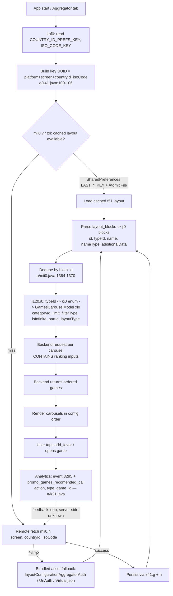

# 04 — Recommendation / Suggestion Algorithms and Free-Spin / Non-Monetary Test Features

**Target:** `D:\1xbetrea\1xbet.apk` — `org.xbet.client1`, `1xbet-prod-v260.1.0`
**Method:** Authorized **static** reverse engineering only. No network calls, no deposits/bets/withdrawals. Evidence from JADX decompiled Java (`D:\1xbetrea\decompiled\sources`), apktool assets (`D:\1xbetrea\apktool_out\assets`), and REA MCP Android tooling.
**Date:** 2026-11-24

## Evidence conventions

| Tag | Meaning |
|---|---|
| **Confirmed** | Directly present in APK assets / decompiled bytecode; reproducible from shipped artifact. |
| **Strongly Supported** | Code path is complete and unambiguous, but the actual backend response/algorithm is not in the APK. |
| **Probable** | Well-supported inference; multiple consistent signals, no direct proof. |
| **Unverified** | Cannot be established from this APK alone (server-side logic, DB, ML weights, etc.). |

> **Single most important caveat:** for both parts the APK is a **thin client**. It decides *where and how to ask*, *how to render*, and *how to animate*. The ranking function and the prize/outcome generator live on the backend. Every claim about "which event wins" or "what the next spin yields" is therefore **Unverified** at the algorithmic level even when the client plumbing around it is **Confirmed**.

---

# PART 1 — RECOMMENDATIONS / SUGGESTIONS

## 1.1 Executive summary

The "recommended" surface is the **Aggregator ("My Games") main screen**. Its structure is **data-driven, not hardcoded**: a JSON layout document (`layoutConfigurationAggregatorAuth.json` / `...UnAuth.json`) defines an ordered list of carousels. Each carousel carries a `nameType` (`recommended`, `favorites`, `viewed`, `top_games`, `slots_popular`, `live_popular`, `crash_popular`) plus *ranking inputs* (`categoryId`, `partId`, `limit`, `filterType`, `isInfinite`, `miniatureType`). The layout document is fetched **per-country** (`COUNTRY_ID_PREFS_KEY`, `ISO_CODE_KEY`), cached in `SharedPreferences` and `AtomicFile`, with the bundled JSON as fallback. The client then converts each block into a `GamesCarouselModel` and asks the backend for the games. **No client-side scoring, weighting, or ML inference exists in the APK** — the only local processing is dedupe-by-id, model conversion, and rendering order. Personalization is evidenced by (a) geo-keyed layout selection, (b) dedicated `favorites` / `viewed` carousels fed by account activity, and (c) analytics events that report recommendation interactions (`promo_games_recomended_call`, `add_favor`, `game_id`, `type`).

## 1.2 The layout configuration assets

### Authenticated layout — `assets/layoutConfigurationAggregatorAuth.json`

`D:\1xbetrea\apktool_out\assets\layoutConfigurationAggregatorAuth.json` (112 lines). Sanitized excerpt (lines 15–25, 27–37, 68–92, 99–110):

```json
{ "nameType": "recommended",
  "additionalData": { "limit": 30, "categoryId": 824, "filterType": "and",
                      "isInfinite": true, "miniatureType": "horizontal" },
  "id": 85, "typeId": 5 },

{ "nameType": "favorites",
  "additionalData": { "limit": 30, "categoryId": 825, "filterType": "and",
                      "isInfinite": false, "miniatureType": "horizontal" },
  "id": 86, "typeId": 5 },

{ "nameType": "viewed",
  "additionalData": { "limit": 30, "categoryId": 847, "filterType": "and",
                      "isInfinite": false, "miniatureType": "horizontal" },
  "id": 88, "typeId": 5 },

{ "nameType": "slots_popular",
  "additionalData": { "limit": 8, "partId": 1, "categoryId": 17,
                      "filterType": "and", "isInfinite": true,
                      "miniatureType": "horizontal" }, "id": 90, "typeId": 5 },

{ "nameType": "live_popular",  { ... "partId": 37, "categoryId": 17, "limit": 8 ... }, "id": 91, "typeId": 5 },
{ "nameType": "crash_popular", { ... "partId": 149, "categoryId": 17, "limit": 8 ... }, "id": 93, "typeId": 5 }
```

Also present: `daily_tasks` (lines 9–13, `typeId 17`), `user_tournaments` (lines 39–45, `typeId 16`), an unnamed `typeId 9` block with `categoryId 981 / limit 100 / vertical` (lines 59–66), `typeId 14` (lines 3–7), `typeId 13` (lines 93–97). **Confirmed.**

### Unauthenticated layout — `layoutConfigurationAggregatorUnAuth.json`

`...UnAuth.json` (87 lines) substitutes `top_games` for `recommended`:

```json
{ "nameType": "top_games",
  "additionalData": { "limit": 12, "categoryId": 824, "filterType": "and",
                      "isInfinite": false, "miniatureType": "vertical" },
  "id": 66, "typeId": 5 },
```
lines 4–14; the same `slots_popular` / `live_popular` / `crash_popular` blocks recur at lines 43–85 with `isInfinite: false`; `tournament_month` at lines 21–27. **Confirmed.**

### Virtual layout — `layoutConfigurationVirtual.json`

`...Virtual.json` (20 lines) contains only `promotions` (`typeId 15`), `typeId 14`, `typeId 6` — no game carousels. **Confirmed.**

**Interpretation (Confirmed for structure / Strongly Supported for semantics):**
- `categoryId 824` = "top games" bucket; `825` = favorites bucket; `847` = "viewed"/recent bucket; `17` = aggregator games catalog; `981` = a large vertical catalog. The numeric IDs are opaque in the APK; the *association* to nameType is proven by co-location in the same block.
- `partId` partitions the catalog by game genre: `1` = slots, `37` = live casino, `149` = crash games. This mapping is independently corroborated by code (§1.7.1).
- `filterType: "and"`, `limit`, `isInfinite`, `miniatureType` are request/UI parameters, not ranking scores. **No `weight`, `score`, `priority`, or `rating` field exists anywhere in these configs** — a notable negative finding.

## 1.3 Data models that deserialize the layout

| Class (obfuscated) | FQCN from serializer descriptor | Role | Citation |
|---|---|---|---|
| `d51` | `org.xplatform.aggregator.impl.core.data.models.AggregatorLayoutConfigurationResponse` | Top-level response; field `layout_blocks` | `a\d51.java:15–17, 26–48` |
| `f51` | (same response) | Holds `List f8937a` = content blocks | `a\f51.java:9–21, 39–41` |
| `hj0` | `org.xplatform.aggregator.impl.core.data.models.AggregatorContentBlockResponse` | Deserializes `id`, `typeId`, `name`, `nameType`, `additionalData` | `a\hj0.java:15–21, 34–71` |
| `jj0` | (block model) | Fields `f16598a=id`, `b=typeId`, `c=name`, **`d=nameType`**, `e=additionalData`; `toString()` labels `d` as `titleType` | `a\jj0.java:11–18, 70–75` |
| `ni0` | `AggregatorContentBlockAdditionalDataResponse` | `limit`, `partId`, `categoryId`, `filterType`, `isInfinite`, `miniatureType` | `a\ni0.java:13–20`; model `a\pi0.java:11–18, 78–85` |
| `xi0` | `GamesCarouselModel` | `id`, `headerModel`, `categoryId`, `limit`, `filterType`, `isInfinite`, `layoutType`, `partId` | `a\xi0.java:9–30, 51–66` |

Sanitized snippet — the field that carries the recommendation type (`a\jj0.java:70–75`):

```java
StringBuilder sbQ = hne.q("AggregatorContentBlockResponse(id=", this.f16598a,
                          ", typeId=", this.b, ", title=");
f140.v(sbQ, this.c, ", titleType=", this.d, ", additionalData=");
```

And the config-to-model conversion (`a\j120.java:1703–1734`, abbreviated):

```java
ti0 ti0VarE0 = i120.e0(jj0Var);                 // header from name/nameType
Integer num  = pi0Var.c;                         // categoryId
int iInt     = pi0Var.f27022a.intValue();        // limit
String str   = pi0Var.d;                         // filterType
boolean z    = pi0Var.e.booleanValue();          // isInfinite
// miniatureType -> pc0 enum, then:
return new xi0(strValueOf, ti0VarE0, num, iInt, str, z, pc0Var, pi0Var.b /* partId */);
```

**Confirmed:** the app turns every configured carousel into a `GamesCarouselModel` carrying exactly the parameters that will be sent upstream. There is no local scoring step in this method.

## 1.4 Layout loader: remote-first with bundled fallback, cached

`a\z41.java` is the layout repository.

- Constructor creates three lazy `n0o0` providers that read the three bundled assets (`a\z41.java:28–98`):

```java
case 0: return z41Var.a("layoutConfigurationVirtual.json");
case 1: return z41Var.a("layoutConfigurationAggregatorAuth.json");
default:return z41Var.a("layoutConfigurationAggregatorUnAuth.json");
```

- `a(String)` opens the asset via `getAssets().open(str)` and deserializes through `f51.Companion.serializer()` (`a\z41.java:108–136`) — **Confirmed**.
- `c(String, mi0, int, String)` is the public accessor. It first calls `e(strB, mi0Var, z)` (remote/cached value). If that throws `g2`, it falls back to the bundled asset providers (`a\z41.java:138–176`, esp. 151–167) — **Confirmed**:

```java
g0g0Var = e(strB, mi0Var, z);
if (j0g0.a(g0g0Var) != null) {          // failure -> bundled default
    if (i2 == 1 && z)      f51Var = (f51) this.e.getValue();   // Auth
    else if (i2 == 1)      f51Var = (f51) this.f.getValue();   // UnAuth
    else                   f51Var = (f51) this.d.getValue();   // Virtual
    g0g0Var = f51Var;
}
```

- `e(...)` reads `SharedPreferences` keys `LAST_AUTH_MY_AGGREGATOR_KEY`, `LAST_UN_AUTH_MY_AGGREGATOR_KEY`, `LAST_AUTH_MY_VIRTUAL_KEY`, `LAST_UN_AUTH_MY_VIRTUAL_KEY` and a `<key>_SCREEN_CONFIG_<uuid>` string (`a\z41.java:182–202`).
- `f(...)` / `g(...)` read/write an `AtomicFile` named `myAggregatorConfiguration<uuid>.json` in `getNoBackupFilesDir()` (`a\z41.java:178–180, 205–264, 267–349`); `h(...)` maintains the "last key" pointers (`a\z41.java:351–375`).
- Cache key is a name-UUID of `(platform byte, screen name, int, string)` (`a\z41.java:100–106`):

```java
byte[] bytes = (str + i + i2 + str2).getBytes(Charsets.UTF_8);
return UUID.nameUUIDFromBytes(bytes).toString();
```

**Conclusion (Confirmed):** the recommendation *layout* is backend-controlled (downloaded config cached locally), and the bundled JSON is only a fallback/default. **Unverified:** the backend endpoint that produces the config and the algorithm that orders the blocks.

## 1.5 Geo is a first-class input to the recommendation layout

`a\knf0.java` supplies the two extra parameters seen in `z41.c(...)` and `mii0.n(...)`:

```java
public final int b() {
    Integer num = this.e;
    return num != null ? num.intValue() : ua80.c(this.b, "COUNTRY_ID_PREFS_KEY", 225);
}
public final String c() {
    String strC = q7d0.c(this.b, "ISO_CODE_KEY");
    return strC == null ? "" : strC;
}
public final lnf0 d() { return new lnf0(c(), b()); }
```
(`a\knf0.java:36–48`; default country id **225**). Also `a()` reads the app GUID with a `FAKE_APP_GUID_ENABLED` / `FAKE_APP_GUID` test override (`a\knf0.java:25–34`).

`a\mii0.java:1393–1395` (and 226, 1358):

```java
iB = knf0Var.b();   // countryId
strC = knf0Var.c(); // ISO code
...
objN = mii0Var.n(str, mi0Var, num, iB, strC, b51Var2);   // remote fetch
...
g0g0Var = ((z41) mii0Var.b).c(str, mi0Var, iB, strC);    // cached/bundled fallback
```

**Confirmed:** the exact same carousel set can differ by country/ISO code. Supporting geo signals in `assets/localConfig.json:3–8, 55`: `WhiteListCountries`, `BlackListCountries`, `HiddenCountriesInProfile`, `NotNeedCheckCurrentGeoIsAllowedCountry`. **Strongly Supported:** geo-targeted catalog/promotion selection. **Unverified:** whether the backend additionally uses IP geolocation beyond the client-supplied country id.

## 1.6 `nameType` semantics

| `nameType` | Where defined (asset) | Parameters | Likely source of ranked items | Confidence |
|---|---|---|---|---|
| `recommended` | Auth JSON L15–25 | categoryId 824, limit 30, infinite, horizontal | Backend recommender for signed-in account | Strongly Supported |
| `top_games` | UnAuth JSON L4–14 | categoryId 824, limit 12, finite, vertical | Backend global/popular ranking | Strongly Supported |
| `favorites` | Auth JSON L27–37 | categoryId 825, limit 30 | Backend list of account favorites | Strongly Supported |
| `viewed` | Auth JSON L47–57 | categoryId 847, limit 30 | Backend recently-viewed history | Strongly Supported |
| `slots_popular` | both, partId 1 | categoryId 17, limit 8 | Backend popularity by slot genre | Strongly Supported |
| `live_popular` | both, partId 37 | categoryId 17, limit 8 | Backend popularity by live-casino genre | Strongly Supported |
| `crash_popular` | both, partId 149 | categoryId 17, limit 8 | Backend popularity by crash genre | Strongly Supported |
| `daily_tasks` / `user_tournaments` / `tournament_month` / `promotions` | Auth/UnAuth/Virtual | none / UI-only | Campaign, tournament & promo backends | Strongly Supported |

`mi0` confirms two platform variants: `MY_AGGREGATOR(2)`, `MY_VIRTUAL(3)` (`a\mi0.java:4–6`).

## 1.7 Part-id → name mapping (corroboration of the genre split)

`a\k21.java:83–111` maps numeric `partId`s to analytics type strings when a user adds a promoted game to favorites:

```java
if (j == 75)      str = "live_1x";
else if (j == 17) str = "slots_popular";
else if (j == -1) str = "recommended";
else              str = j == 37 ? "live_aggregator_popular" : "null";
...
kt2Var.a("promo_games_recomended_call",
         xp20.f(new Pair("action","add_favor"),
                new Pair(Payload.TYPE, str),
                new Pair("game_id", Long.valueOf(j5))));
```

The same call is also emitted as analytics event id **3295** via `x20Var.f40143a.a(tx3.l0(...), 3295L)` (`a\k21.java:96`). This is a **feedback signal**: the app reports which recommendation type produced a favorite action, and for which game. **Confirmed** that the event is emitted; **Unverified** whether/when the backend uses it to re-rank.

Complementary analytics seen: `a\kgb0.java:314–318` logs `games_promos_popular_call` with `point=lucky_wheel`, event id **12012**; `a\jm8.java:426–435` logs `games_bonus_games_call` with `point=lucky_wheel`; `a\am10.java:57` / `a\bo10.java:302` log `games_promos_lucky_wheel`.

## 1.8 Local processing vs backend ranking

**Local processing (Confirmed):** `a\mii0.java:1364–1391` and `a\zri.java:482–505` do exactly three things:

1. `HashSet` dedupe of blocks by `jj0.f16598a` (block id);
2. `j120.i0(block, platform)` conversion, discarding blocks that fail conversion;
3. return the ordered `List<gj0>` — the **asset/backend order is preserved**; no `sort`, `compare`, `weight`, or `score` call occurs.

**Backend ranking (Strongly Supported):** because the client only carries `categoryId`, `partId`, `limit`, `filterType` upstream and never scores, the ordering of returned games must be produced by the backend. **Unverified:** whether that backend uses collaborative filtering, popularity counts, absolute counts, or manual merchandising.

**No ML model in APK (Probable):** no `.tflite`, `.mlmodel`, ONNX, or on-device inference library was observed in the relevant package paths; no scoring code accompanies the carousel models. (A full binary-wide asset inventory was not performed for this deliverable, so this is stated as Probable, not Confirmed.)

## 1.9 Behavioral / account signals — what the APK actually shows

| Signal | Evidence | Confidence |
|---|---|---|
| Geo / country | `COUNTRY_ID_PREFS_KEY`, `ISO_CODE_KEY` used as layout key (`a\knf0.java:36–48`, `a\mii0.java:1393–1395`) | Confirmed |
| Account favorites | `favorites` carousel, categoryId 825 (`Auth.json:27–37`); `k21.java` logs `add_favor` | Confirmed (surface + telemetry) |
| View history | `viewed` carousel, categoryId 847 (`Auth.json:47–57`); `FavoritesInternalNavigation$favoriteDashboardViewedFragment$1.java` | Confirmed (surface) |
| Auth state | separate Auth/UnAuth layouts; `mi0`/`z41` choose by `z` = signed-in flag (`a\z41.java:144–165`) | Confirmed |
| Interaction with recommendations | `promo_games_recomended_call` + event 3295 (`a\k21.java:96–111`) | Confirmed |
| Betting-pattern-based scoring | none found | Unverified |
| Location beyond country id (GPS/IP) | no recommendation-specific code found | Unverified |

**Note:** `assets/localConfig.json:52` contains `ShopPopularPersonalizationTips: true` — a UI tips flag, **not** evidence of a personalization algorithm. It should not be over-read.

## 1.10 Recommendation generation — Mermaid



---

# PART 2 — FREE SPINS AND NON-MONETARY TEST FEATURES

## 2.1 Feature inventory and entry points

| Feature / module | Entry point classes (decompiled) | Monetary? | Outcome source |
|---|---|---|---|
| **Lucky Wheel** | `a\fm10.java` (fragment), `a\bo10.java` / `a\pn10.java` (ViewModels), `a\bn70.java` (holder), `a\dm10.java` (state→animation), `org\xplatform\lucky_wheel\presentation\views\WheelView.java` | Can be **free** or **for money** (button strings both exist, §2.3) | Backend `LuckyWheelBonus` |
| **Spin & Win** | `org\xplatform\spin_and_win\...\SpinAndWinWheelView.java`, `SpinAndWinChoiceView.java`; VMs `a\tyk0.java`, `a\u90.java`, `a\qyk0.java`, `a\r90.java` | Promotional / free | Backend-derived `csr` in VM state |
| **Scratch Card** | `org\xplatform\scratch_card\...\ScratchCardView.java`, `ScratchCardFieldView.java`, `ScratchCardProtectLayerView.java` | Promotional | Card contents supplied as `c7h0.f` list (model) |
| **Lucky Card** | `org\xplatform\core\presentation\custom_views\cards\LuckyCardWidget.java`, `a\jj10.java` | Promotional | Backend sets card face; client RNG picks *reveal index* |
| **Bonus games** | `org\xplatform\bonus_games\...` (`LotteryView`, `MemoryGameView`, `NineTreasuresView`, `ErasableView`) | Promotional | Backend game state |
| **Wild Free Bet** | `org\xplatform\wild_free_bet\...\WildFreeBetScreens$SelectGameScreen.java`, `a\ffv0.java`, `a\bn70.java` (holder bonus) | Free bet | Backend bonus |
| **Demo/simulation game cards** | `dragons_gold`, `apple_fortune`, `eastern_nights`, `african_roulette`, `games_mania`, `domino`, `crystal`, `playersduel` (custom views) | Visual game clients | Backend game state |
| **Test Section (office tool)** | `a\p1q0.java` (hub), `a\stc.java` (Client Config), `a\lgf0.java` (Remote Config test), `a\q1j0.java`, `a\ttc.class`, `a\igf0.java` | Non-monetary tooling | Local + backend config |
| **Swipex onboarding mock cards** | `a\ypn0.java`, `a\qvi.java`, `a\yuu.java`; assets `cardsENG.json`, `cardsRU.json`, `gameEventsCard*.json` | **Non-monetary tutorial** | Hardcoded local assets |

## 2.2 Outcome model — the prize enum and backend wire format

`a\esr.java:17–24` — client-side outcome enum (`f8344a` is the numeric code):

```java
NOTHING(0), DOUBLE_BONUS(1), RETURN_HALF(2), FREE_BET(3),
FREE_SPIN(4), WILD_FREE_BET(5), SPECIAL_BONUS(666);
```

`a\uk10.java:20–27` — **the same enum as a backend string field** (JSON values are strings):

```java
NOTHING("0"), DOUBLE_BONUS("1"), RETURN_HALF("2"), FREE_BET("3"),
FREE_SPIN("4"), WILD_FREE_BET("5"), SPECIAL_BONUS("666");
```

`a\ok10.java:16–27` — serializer descriptor for `org.xplatform.core.data.LuckyWheelBonus`, revealing the backend JSON field names:

```java
zna0Var.j("BNTID", true);              // bonus type id -> uk10
zna0Var.k(new iy(new String[]{"BT","BNTP"}, b)); // description
zna0Var.j("BNC", true); ... {"BC"}     // bonus enabled
zna0Var.j("GID", true);                // gameTypeId
zna0Var.j(TokenNames.E, true); zna0Var.j("CNT", true);   // count
zna0Var.j("TLM", true);                // remaining time
zna0Var.j("FBSE", true);               // free bet sum
```

`a\rk10.java:90–104` is the matching model (`toString()` prints `LuckyWheelBonus(bonusType=..., count=..., remainingTime=..., freeBetSum=...)`; fields `f30625a` type, `b` description, `c` gameTypeId, `d` enabled, `e` count, `f` remainingTime, `g` freeBetSum).

Mapping from backend to client outcome is a pure switch — `a\eeq.java:1055–1078`:

```java
public static final esr T(Integer num) {
    if (num != null && num.intValue() == 0) return esr.NOTHING;
    ...
    if (num != null && num.intValue() == 5) return esr.WILD_FREE_BET;
    if (num != null && num.intValue() == 666) return esr.SPECIAL_BONUS;
    jf4.k("Not supported bonus type"); return null;
}
```

Also `a\d5c.java:726–760`, `a\qk10.java:5–36`, `a\tdc.java:915–916` perform the same `uk10 → esr → csr` conversion. `csr` = `GameBonus` with `bsr` = `BonusIdentifierDetails(esr, amount, multiplier)` (`a\csr.java:7–20, 45–47`; `a\bsr.java:36`).

**Confirmed:** no RNG is involved in choosing `esr`; it is decoded from a backend field.

## 2.3 Lucky Wheel — full execution reconstruction

### Request

`a\hzk0.java:13–16` / `a\jzk0.java:9–45`:

```java
new zna0("org.xplatform.lucky_wheel.data.requests.SpinWheelRequest", ..., 2);
zna0Var.j("WF", false);   // freeSpin  (boolean)
zna0Var.j("BAC", false);  // walletId  (long)
...
public final String toString() {
    return "SpinWheelRequest(freeSpin=" + this.f17418a + ", walletId=" + this.b + ")";
}
```

This is the decisive evidence for the free-vs-paid distinction: **the client merely flags `freeSpin` and names a `walletId`; the backend decides the result.** **Confirmed.**

Wheel sectors are also backend-provided: `a\fav0.java:13–15` → `WheelSectionResponse` with field `BTID` (bonus type id), model `a\hav0.java:38` (`WheelSectionResponse(bonusType=...)`).

### ViewModel and animation

- `a\bo10.java` (LuckyWheelGameViewModelOld) owns state. Field `H` is `x9v0` = `WheelInfo(freeSpinCounts, freeSpinTimer, winBonus, wheelSectors, balance, accountId)` (`a\x9v0.java:18–25, 44–51`).
- Button labels prove both modes (`a\bo10.java:242, 251`): `lucky_wheel_spin_for_money`, `lucky_wheel_free_spin_with_count_v2`, and `lucky_wheel_spin_all_v2` with `Integer.min(i, 100)` (spin-all capped at 100 free spins).
- On spin completion the VM writes a `mav0` WheelState whose `c`/`d` fields are the **target esr** (`a\bo10.java:232`): `new mav0(true, x9v0Var.d /* wheelSectors */, null, null, false)`.
- `a\dm10.java:110–148` consumes that state and **animates to the already-decided sector**:

```java
ArrayList<iav0> wheelItems = mav0Var.b;
fm10Var2.G0().t.setWheelItems(wheelItems);
esr esrVar = mav0Var.c;                 // predetermined outcome
if (esrVar != null) {
    ValueAnimator a = ((WheelView) luckyWheelView.q.f).a(2, esrVar);
    ...
    esr esrVar2 = mav0Var.d;            // second (result) spin: 7 rotations
    ValueAnimator a2 = wheelView.a(7, esrVar2);
```

- `org\xplatform\lucky_wheel\presentation\views\WheelView.java:50–81` — the view does **no** randomization; it computes a rotation angle that lands on the supplied `esr` sector:

```java
public final ValueAnimator a(int i2, esr esrVar) {
    int i3 = 0;
    for (iav0 iav0Var : this.b) {
        if (iav0Var.b == esrVar) {
            float angle = getItemSectorAngle();          // 360 / sectors
            return ValueAnimator.ofFloat(getRotation()%360,
                (360 - (i3*angle + rotation)) + i2*360 + rotation + 90);
        }
        i3++;
    }
    ...
}
```

Special handling: `esr.WILD_FREE_BET` / `esr.FREE_BET` sectors are matched via `esrVar.b()` (`WheelView.java:54–63`), consistent with `esr.b()` = `this == WILD_FREE_BET` (`a\esr.java:54–56`).

**Confirmed:** the wheel animation is a **presentation of a backend-decided result**, not a physical RNG. A user cannot influence the stop position by timing the tap.

### Free-spin count / state

- Wheel info supplies `freeSpinCounts` (`x9v0.f40528a`) and `freeSpinTimer` (`x9v0.b`) — backend fields.
- Agent gifts fragment keeps navigation args `BONUSES_COUNT`, `FREE_SPINS_COUNT`, `GIFT_TYPE_ID`, `AFTER_AUTH` (`a\e11.java:24, 30–33`) — these are `SavedStateHandle` keys, not an independently maintained local wallet.
- Action `REQUEST_FREE_SPIN` exists in `a\cu60.java:140` (Compose state machine).
- Result icon for FREE_SPIN: `a\bo10.java:740` (`R.drawable.ic_result_free_spin`).

**Confirmed:** counters/balances arrive from backend `WheelInfo`/`GameBonus` and are displayed; **Unverified:** backend ledger implementation.

## 2.4 Spin & Win, Scratch Card, Lucky Card, bonus games

### Spin & Win
`a\qyk0.java:43–60` and `a\r90.java:45–67` both read the outcome from stored GameBonus state and then animate the selected button:

```java
esr esrVar2 = tyk0Var.e.a().f4905a.f3145a;   // GameBonus -> esr
if (esrVar2 == esr.DOUBLE_BONUS || esrVar2 == esr.FREE_BET ||
    esrVar2 == esr.RETURN_HALF || esrVar2 == esr.WILD_FREE_BET) { ... }
t0u t0uVar = tyk0Var.y; ...                    // animate chosen button
```

`org\xplatform\spin_and_win\presentation\views\SpinAndWinChoiceView.java:51–96` only lays out six colored buttons and assigns click listeners; `SpinAndWinWheelView.java:30–54` only inflates the wheel and an end-of-animation callback. **Strongly Supported:** backend-decided outcome, client animation.

### Scratch Card
`org\xplatform\scratch_card\presentation\views\ScratchCardView.java:39–73` builds a 3×3 field from **model-supplied** `c7h0Var.f` list:

```java
ArrayList arrayListR = r3d.r(c7h0Var.f);
for (int idx : l1e0.o(0, 9)) {          // Kotlin random permutation of 0..9
    int iNextInt = ((bkx) it).nextInt();
    y6h0Var.b((z6h0) arrayListR.get(iNextInt));   // shuffle *placement* only
}
```

`bkx` is the Kotlin `kotlin.random.Random` iterator (`a\bkx.java:9, 12`) used throughout the app for view/position shuffling. **Confirmed:** the *set* of symbols is supplied by the model; **only their on-screen positions are shuffled locally**. **Strongly Supported:** model comes from backend game state (same `c7h0`/game framework as other bonus games); final prize attribution is backend-side.

### Lucky Card
`org\xplatform\core\presentation\custom_views\cards\LuckyCardWidget.java:32, 41` holds `Random j = new Random()` and `k = 4` cards (from XML attr, default 4). The **card face** is set from a suit/rank integer before animation (`a\jj10.java:190–225`), then:

```java
luckyCardWidget2.i = random.nextInt(luckyCardWidget2.k - 1) + 1;  // a/jj10.java:227
int i4 = random.nextBoolean() ? -1 : 1;                            // a/jj10.java:229
```

These two `java.util.Random` calls pick **which card in the stack is revealed and the flip direction** — i.e. cosmetic choreography around a face that was already assigned by game state. **Confirmed:** client RNG exists here but does not generate the win/lose value; **Strongly Supported:** prize value is backend-driven.

### Bonus games
`org\xplatform\bonus_games\impl\lottery\presentation\views\LotteryView.java`, `...memories\...\MemoryGameView.java`, `...treasure\...\NineTreasuresView.java` are rendering views; their state comes from the same game framework. **Strongly Supported:** backend state, local animation.

## 2.5 RNG audit (what is actually random on the client)

| Location | RNG | Purpose | Outcome-relevant? |
|---|---|---|---|
| `a\bkx.java`, Kotlin `nextInt()` in ~50 view classes | `kotlin.random.Random.Default` | Choosing view ids, measure positions, shuffling symbol placement | **No** — cosmetic/layout |
| `org\xplatform\core\...\LuckyCardWidget.java:41`, `a\jj10.java:227,229` | `java.util.Random` | Reveal index & flip direction | **No** — cosmetic |
| `org\xplatform\domino\...\DominoHandView.java:162–164` | `java.util.Random` | Picks a tile from the remaining visual list | **No** for money; visual demo game |
| `a\itj0.java:14–69` | `java.util.Random` (reseeded via `new Random(random.nextLong())`) | Fisher–Yates-like no-immediate-repeat sequence generator | No — used by game containers for visual variety |
| `a\jj10.java`, `a\m6x0.java:1427`, `a\dmo.java:3541` | mixed | selection/animation | No |
| `SecureRandom` sites (`a\g1e0.java:13`, `a\jwn.java:15–43`, `a\joq0.java:82`, `a\eii0.java:92`) | `SecureRandom` / SP800 | TLS, key generation, cryptography | **No** — not game outcomes |
| `Math.random()` (`a\a03.java:74`, `a\ejx.java:57`, `a\g4x0.java`) | — | retry jitter/backoff | No |

**Conclusion (Confirmed for the audited sites):** there is **no client-side prize RNG and no probability table / weighting table for free spins in this APK**. Probability weights, if any, are server-side. **Unverified:** backend RNG fairness, seeds, or payout tables.

## 2.6 Testing modes and environment isolation

The app ships an internal **Test Section** (`org\xplatform\feature\office\test_section\impl\navigation\TestSectionScreen$*.java`) with screens:

- `TestSectionScreen` → fragment `a\p1q0.java` — the hub; list of buttons driven by `ButtonClickEvents` (`a\p1q0.java:93–103`), with ~30 injected dependencies (`a\p1q0.java:53–84`).
- `ClientConfigScreen` → `a\stc.java` — displays/copies client config (`ClientConfigViewModel$CopyUiAction`, `a\stc.java:74–77`).
- `RemoteConfigTestScreen` → `a\lgf0.java` — Compose UI with `FILTERS_BS_DIALOG_REQUEST_KEY` (`KEYS_FILTER_TYPE`, `KEYS_SORT_TYPE`) and `CHANGE_VALUE_BS_DIALOG_REQUEST_KEY` allowing **filtering and changing remote-config values** (`a\lgf0.java:26–82, 83–138`).
- `DemoConfigScreenFactoryImpl$getScannerDemoConfigScreen$1.java` — a demo-config **scanner** entry point.

The test config model `a\l1q0.java:87–105` (`TestSectionCommonItemsModel`) exposes:

```
testServerStage, testServerGame, luxuryServer, testBanners, testAggregator,
checkGeo, marketNumberVisibility, allowDebugIframe, fakeLetters, appGuid,
isTestBuild, country, appVersion, highlightDesignSystem, sipCRMTest, sipCRMV2Test,
showPushInfo, testSpecialEvent, newAppStartPartner, dynamicThemeSwitchingEnable,
testDomainEnabled, isTestToolsEnabled, manualTestDomain, isTestRemoteConfigEnabled,
isFakeAppGuidEnabled, logFailedEventParams, internetEmulationEnabled,
multiplyStringsEnable
```

Additional test/demo switches:

- `a\ot10.java:236–239`: if `singlUrl` is empty and the build is test/debug with no test-domain override, the endpoint becomes **`https://hfoweytnvkf.com`** — a dedicated test host.
- `a\tff0.java:32–34`: `ConfigCacheKey(serverEndpointType=..., demoMode=false, testSectionOverrideConfigEnable=...)` — the test section can override config resolution.
- `a\yyk.java:8, 26, 74–75`: `isTest` / `getDebug()` / `getTestDomainEnabled()` on the environment config.
- `a\m71.java:39` (AggregatorGameFragment args): `demoAvailable`, `isDemo`, `bonusGame`, `balanceId`, `gameUrl`, `lobbyUrl` — games can be launched in **demo mode** or as a **bonus game**, distinct from a paid launch.
- `a\rir.java:11`, `a\s9r.java:55`: `GPWebAppDemoStatus` = `disabledDemoMode`, `authWithoutDemoBalance`, `notAuthWithoutDemoBalance`, `toggleDemoGameAvailable`.
- `a\zv0.java:25, 30`: response fields `isDemoAvailable`, `isTest`.
- `a\cwr0.java:513`: analytics/request param `isTest`.

**Answer to "do test spins touch production?":**
- **Default/production build (Confirmed):** free spins are ordinary backend requests flagged `freeSpin=true` (`a\jzk0.java:39`) against the normal production endpoint. They are *non-monetary in outcome* but are **not isolated** — they are real account-bound promo operations.
- **Test-section mode (Strongly Supported):** the Test Section can redirect game/server endpoints (`testServerStage`, `testServerGame`, `manualTestDomain`, test host in `a\ot10.java`), override remote config, fake the app GUID and country, and emulate internet conditions. In such a configuration, spins would target test infrastructure instead of production. Whether a given device/test session actually has these flags enabled **cannot be determined statically** (Unverified).
- **Demo game launch (Confirmed flag):** `isDemo` is a game-launch argument; demo games use play money rather than real balance. This is a different axis from "free spin".

**Different algorithms per mode? No evidence of distinct algorithms in the APK (Confirmed for client side):** all modes decode the same `uk10 → esr → csr` model. Any per-mode probability differences would be backend-side (Unverified).

## 2.7 Card JSON assets — their real role

| Asset | Parser / model | Loading site | Role |
|---|---|---|---|
| `cardsENG.json`, `cardsRU.json` | `pja` = `{cards:List, switchFilter:Boolean, timestamp:Long}` | `a\yuu.java:44–142` (two lazy providers, one per language) | **Static mock sports-event cards** (3 football matches: Real Madrid–Barcelona, Arsenal–Man City, Man Utd–Liverpool, with fixed odds) |
| `gameEventsCardOne.json`, `gameEventsCardTwo.json`, `gameEventsCardThree.json` | `d600` = `{id:Integer, constId:Integer, events:List}` | `a\qvi.java:19–93, 94–...` | **Static mock event markets** (over/under, 1X2, handicaps) for the same three `id`/`constId` pairs as `cardsENG/RU` |

`a\yuu.java:57` / `:75` and `a\qvi.java:38/56/74` call `getAssets().open(...)` and deserialize with Kotlinx serialization — **Confirmed**.

`a\qvi.java:19–27` is invoked from `a\msi.java:130–137` (DI case 6) and consumed by `a\ypn0.java:115/190/265`:

```java
return new q0h0((qvi) ((rvi) ypn0Var.b2.getValue()).w.get());
```

`a\ypn0.java` metadata identifies it as the **Swipex onboarding fragment** (`SwipexOnboardingFragmentBinding`, `R.layout.swipex_onboarding_fragment`, `CardStackLayoutManager`).

**Conclusion (Confirmed):** these JSON files are **hardcoded sample sports-betting cards shown in the Swipex onboarding/tutorial** — i.e. a non-monetary demonstration of how betting cards look. They are **not** free-spin outcome tables, not probability tables, and not connected to the lucky-wheel / spin-and-win engines. Their `cf` values are illustrative fixed odds embedded in the APK.

## 2.8 Free-spin execution — Mermaid

```mermaid
sequenceDiagram
    participant U as User
    participant F as Fragment (a/fm10, a/fm10-like)
    participant VM as ViewModel (a/bo10 / a/tyk0 / a/u90)
    participant API as Backend
    participant V as WheelView / SpinAndWinChoiceView / ScratchCardView

    U->>F: tap "free spin" / "spin all"
    F->>VM: spin(freeSpin=true, walletId)
    VM->>API: SpinWheelRequest {"WF": true, "BAC": walletId}<br/>(a/hzk0.java, a/jzk0.java)
    API-->>VM: WheelInfo + LuckyWheelBonus / game state<br/>{"BNTID":"4"|"5"|"666", "CNT":n, "FBSE":x, "TLM":t}<br/>(a/ok10.java, a/rk10.java)
    VM->>VM: uk10 -> esr (pure switch)<br/>a/eeq.T(), a/d5c.a0(), a/qk10.a()
    VM->>VM: build GameBonus csr / WheelState mav0<br/>a/csr.java, a/x9v0.java
    VM->>F: emit WheelState(target esr, wheelSectors)
    F->>V: setWheelItems(sectors)
    F->>V: animate(target esr, rotations=2 or 7)
    Note over V: WheelView.a() computes rotation to LAND ON<br/>the pre-decided sector — no local RNG<br/>(lucky_wheel/WheelView.java:50-81)
    V-->>U: result icon/text; count/balance from backend
    VM->>API: analytics: games_promos_lucky_wheel /<br/>games_bonus_games_call (a/am10, a/kgb0, a/jm8)
```

## 2.9 Paid vs free spins — differences (Confirmed where noted)

| Dimension | Free spin | Real-money spin |
|---|---|---|
| Trigger flag | `SpinWheelRequest.WF = true` (`a\jzk0.java:39`) | `WF = false` |
| Wallet | `BAC` walletId still sent | `BAC` walletId sent |
| Outcome generation | Backend (same enums) | Backend (same enums) |
| Button label | `lucky_wheel_free_spin_with_count_v2` / `spin_all_v2` | `lucky_wheel_spin_for_money` (`a\bo10.java:242,251`) |
| Balance effect | Free-spin count decremented server-side; no stake | Real balance debited (`x9v0.e` balance field) |
| Animation engine | Same (`WheelView.a`) | Same |
| Test isolation | Production backend by default; optional test-section endpoint override | Same |

---

# PART 3 — CONCLUSIONS, UNKNOWNS, AND WHAT IS MISSING

## 3.1 What the APK proves

1. **Recommendations are configuration- and backend-driven.** The layout JSON (`nameType` + `categoryId` + `partId` + `limit` + `filterType` + `isInfinite` + `miniatureType`) is authoritative for *what kinds* of carousels appear and in what order; the backend fills them with ranked items. Bundled assets are fallbacks only.
2. **Geo is a key input** — country id and ISO code select the layout. Favorites/viewed carousels expose account-history personalization; telemetry reports interaction with recommendation types back to the server.
3. **No client-side ranking/ML and no client-side prize RNG** were found in the audited paths. The wheel/scratch/card animations visualize server responses. `SecureRandom` usage is cryptographic, not gaming.
4. **Free spins are real backend operations** flagged `WF=true`, not simulated local lotteries. The Test Section can redirect endpoints/config to test infrastructure, but that is a separate, opt-in developer mode.

## 3.2 What remains genuinely unknown (and why)

| Question | Status | Why |
|---|---|---|
| Exact backend algorithm / weights / ML model for `recommended` | **Unverified** | Server-side only; APK contains no scoring code. |
| Whether the server actually consumes `promo_games_recomended_call` for re-ranking | **Unverified** | Telemetry emission is proven; server consumption is not. |
| Meaning of opaque ids `824/825/847/17/981` and `partId 1/37/149` | **Strongly Supported (mapping) / Unverified (server taxonomy)** | Co-location and analytics strings prove the mapping, not the backend schema. |
| Backend RNG fairness, probability tables, house edge for spins | **Unverified** | No tables in APK; `BNTID` is decoded as a string enum. |
| Whether other behavioral data (bets, session length, device) personalizes ranking | **Unverified** | Not observable statically; would require request capture/backend access. |
| Whether a specific device has test flags enabled | **Unverified** | Runtime SharedPreferences/remote-config state not present in APK. |
| Contents of encrypted `assets/remote-config/remote-config.json` (68,121 bytes, `{"dataHex":"17148667d7cf..."}`) | **Unverified** | Encrypted blob; decryption key/algorithm not established in this pass. Could contain additional feature flags affecting ranking — explicitly **not** assumed. |

## 3.3 High-value follow-ups (out of scope here)

- Decrypt `remote-config.json` (locate the key derivation near the config manager) and diff flags against `localConfig.json`.
- Capture (in an authorized staging environment) one Aggregator layout fetch and one `SpinWheelRequest`/response to confirm parameter names and ordering.
- DEX-level xref of `mii0.n()` and `uac0` transport to enumerate the exact endpoint identifiers for the layout/games APIs.
- Full scan for `.tflite`/ONNX assets to downgrade/upgrade the "no on-device ML" finding from Probable to Confirmed.

---

### Appendix A — Key file index

| File | Why it matters |
|---|---|
| `apktool_out/assets/layoutConfigurationAggregatorAuth.json` / `UnAuth.json` / `Virtual.json` | Recommendation carousel definitions |
| `apktool_out/assets/cardsENG.json`, `cardsRU.json`, `gameEventsCardOne/Two/Three.json` | Swipex onboarding mock cards |
| `apktool_out/assets/localConfig.json`, `remote-config/remote-config.json` | Feature flags / encrypted remote config |
| `decompiled/sources/a/z41.java` | Layout repository (remote + bundled fallback, caching) |
| `decompiled/sources/a/d51.java`, `hj0.java`, `jj0.java`, `ni0.java`, `pi0.java`, `f51.java`, `xi0.java` | Layout/block/carousel models |
| `decompiled/sources/a/mii0.java`, `zri.java`, `j120.java`, `knf0.java`, `mi0.java` | Layout consumption, dedupe, geo inputs, model conversion |
| `decompiled/sources/a/k21.java` | Recommendation→favorite analytics (`promo_games_recomended_call`) |
| `decompiled/sources/a/esr.java`, `uk10.java`, `ok10.java`, `rk10.java`, `csr.java`, `bsr.java`, `eeq.java`, `d5c.java`, `qk10.java` | Outcome enums and backend↔client mapping |
| `decompiled/sources/a/hzk0.java`, `jzk0.java`, `fav0.java`, `hav0.java`, `x9v0.java`, `mav0.java` | Spin request, wheel sectors, wheel info/state |
| `decompiled/sources/a/bo10.java`, `pn10.java`, `dm10.java`, `fm10.java`, `tyk0.java`, `u90.java`, `qyk0.java`, `r90.java` | Spin ViewModels and state→animation wiring |
| `decompiled/sources/org/xplatform/lucky_wheel/.../WheelView.java` | Predetermined-outcome animation |
| `decompiled/sources/org/xplatform/spin_and_win/...`, `scratch_card/...`, `core/.../LuckyCardWidget.java`, `a/jj10.java` | Other free games and cosmetic RNG |
| `decompiled/sources/a/p1q0.java`, `stc.java`, `lgf0.java`, `l1q0.java`, `ot10.java`, `tff0.java`, `m71.java`, `rir.java` | Test section, demo mode, endpoint overrides |
| `decompiled/sources/a/yuu.java`, `qvi.java`, `ypn0.java`, `msi.java` | Swipex onboarding mock-card loading |
