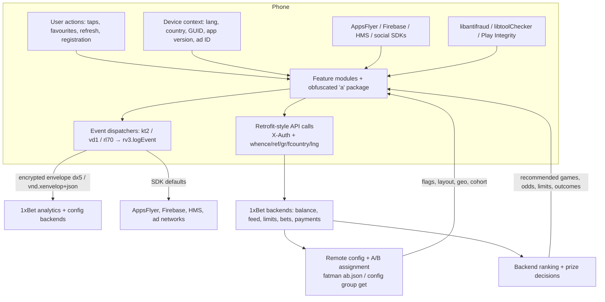

# 20. Behavioural Data Collection, Personalisation & Downstream Forwarding

## 20.0 Scope and method

This section is a static, read-only analysis of `D:\1xbetrea\1xbet.apk` (package `org.xbet.client1`, `1xbet-prod-v260.1.0`, SHA-256 `d0ae8e422e47b480c20fa170c5ff85e67ee6074a1ac106ce0f75890cb8a3133d`). Sources: 69,001 JADX-decompiled Java files in `decompiled/sources`, apktool-decoded assets in `apktool_out`, REA JADX analysis, and a read-only cross-check of `https://indian.1xbet.com/en` (report `06_website_crosscheck.md`). No APK execution, account login on our behalf, transaction, or real-money action was performed.

Confidence labels: **Confirmed** = directly visible in shipped code/config/network capture; **Strongly Supported** = several consistent code paths but no runtime proof; **Probable** = reasonable inference with material gaps; **Unverified** = needs backend, native key, or device capture.

## 20.1 Executive summary

The app collects four kinds of behavioural input: (1) explicit interaction events (favourites, recommendation taps, deposit-page actions, registration/profile choices); (2) environmental context attached to almost every request (language, country, currency, app/session GUID, `whence`/`ref`/`gr` partner parameters, auth state, first-deposit flag, app version); (3) identifiers (account ID, AppsFlyer ID, Firebase installation ID, FCM token, `fatman_uuid`, session token); and (4) device-integrity signals from native anti-fraud libraries.

That data is used locally only in a limited way — mostly to build request parameters and choose which cached/remote layout to show. The actual decisions (what is "recommended", what limits apply, which promotions appear, which backend host serves the app) are made by the backend. The website cross-check confirmed the same mechanism there: a config service, an A/B endpoint (`fatman-api/<id>/ab.json`), analytics POSTs, and A/B flags named `fatmanAbToRechargeA/B/C` on the recharge flow.

Data is forwarded to 1xBet backends and, through bundled SDKs, to third parties (AppsFlyer, Firebase Analytics/Crashlytics, Google/HMS ad-ID and push services, social login SDKs, reCAPTCHA, support chat). Several response/request bodies use an encrypted envelope (`Accept: application/vnd.xenvelop+json`, type `dx5`), so the exact field list inside those payloads cannot be enumerated statically.

## 20.2 What is collected — evidence table

| Category | Concrete evidence (file : line / source) | Data items | Confidence |
|---|---|---|---|
| Favourites / interests | `a/k21.java:96,101,111`; `a/ih5.java:58`; `a/mii0.java:588`; `a/ix0.java:123` | `add_favor` / `remove`, event ID **3295**, `game_id`, `type`; `cyber_champ_favor_add` with `sport_id`, `sub_sport_id`, `championship_id`, `screen`, `point` (live/line), `action`; `bet_add_favor` | **Confirmed** |
| Recommendation feedback | `a/k21.java:111` | `promo_games_recomended_call` with `type` and `game_id` — explicit feedback on suggested games | **Confirmed** |
| Payment-funnel behaviour | `a/db90.java:182,301`; `a/l890.java:77` | `dep_refresh_method` (refresh count/behaviour), `dep_done` (with parameter map), `dep_error` | **Confirmed** |
| Registration / profile choices | `a/eye0.java:71-119`; `a/j1l0.java:273`; `a/dc0.java:209`; `a/hi70.java:167` | Picker analytics for country, city, currency, document type, region, phone; each tagged with `AnalyticsEntryPoint` | **Confirmed** |
| Request context on ordinary APIs | `a/a0g.java:11`, `a/b9s0.java`, `a/c4j.java:12`, `a/cq0.java:11,19`, `a/et5.java:21-36`, `a/gkb.java:2134`, `a/g45.java:2128` | `ref`, `partner`, `whence`, `fcountry`/`country`, `gr`, `lng`, `curIso`, `isAuthorized`, `hasFirstDeposit`, `applicationVersion`, `limit`, `skip`, header `x-whence: 22` | **Confirmed** |
| Device/session identifiers | `a/a1q.java:27`, `a/kb8.java:17`, `a/ao4.java:49`, `a/a3n0.java:185,392`, `assets/init.json` | AppsFlyer ID; app GUID/session (`AuthSessionHistoryUiItemModel.appGuid`, `h_guid`); debug overrides `FAKE_APP_GUID_ENABLED`/`FAKE_APP_GUID`; `fatman_uuid` | **Confirmed** |
| Auth/session tokens | `a/btt0.java:15-26`; `a/s980.java:490-498` | `new_user_token`, `X-Auth: Bearer <token>`; payment WebView headers `X-Deeplink`, `X-Referral`, `X-Mobile-Project-Id: 1357` | **Confirmed** |
| Third-party SDK telemetry | `com/appsflyer/AppsFlyerLib.java:62-64`; `a/rv3.java:159`; `com/google/android/gms/measurement/**`; Firebase Crashlytics classes; `a/m8d.java:28` | AppsFlyer `logEvent(name, map)`; Firebase Analytics/Crashlytics events and crashes; `HasCustomerIo` flag (false in this build) | **Confirmed** (SDK presence); payload contents **Unverified** |
| Device integrity / anti-fraud | `libantifraud.so`, `libantifraud_audio.so`, `libtoolChecker.so`, `libsdk_bc_lib.so`; manifest permissions | root/emulator/tool detection, audio-based fraud checks, Play Integrity signals | **Strongly Supported** (native internals not executed) |
| Web platform A/B (cross-check) | `https://indian.1xbet.com/en` network capture + JS bundle | `POST /fatman-api/<id>/ab.json`, `fatmanAbToRechargeA/B/C`, `fatmanAbHideNavOnReg`, `GET /bff-api/config/group/get?groups=...&lang=...`, `POST /analytics-module-api/v1/analytics` | **Confirmed** (web, not APK) |

## 20.3 Data flow

## 20.4 How the collected data changes the app's behaviour

1. **Remote config gates features.** `a/wti.s()` reads the encrypted asset, `a/mwn` parses `dataHex`/`ivHex`, `a/nrd.a()` → `a/ref.a():31` performs AES/CBC/PKCS5Padding with the key from native `KeysImpl.getNativeConfigKey(0/1)` (`KeysImpl.java:1328`). `a/rxn.java:144-181` merges fetched over saved over bundled values, re-encrypts and persists. Flags include `hasFinancialSecurityDepositLimits`, `hasMAXBet`, `blockApp`, `paymentRefreshLimit` — so server-side flags can change betting and financial UI/behaviour without an app update. **Confirmed (mechanism); live values Unverified.**

2. **Geo and account state select the layout.** Country ID (default 225) and ISO code are inputs to the layout key (`a/knf0.java:38,42`; `a/mii0.java:1393-1395`). Bundled `layoutConfigurationAggregatorAuth/UnAuth/Virtual.json` are fallbacks; remote layout wins and is cached in SharedPreferences/`AtomicFile` by `a/z41.java`. Dedicated country modules (`limits_africa`, `limits_ee`, `limits_kenya`, `limits_ne`) show that regional rules are first-class. `isAuthorized`, `hasFirstDeposit`, `curIso` and account ID are request parameters to several endpoints. **Confirmed.**

3. **A/B experimentation.** The APK carries `fatman_uuid`; the website calls `fatman-api/<id>/ab.json` and defines `fatmanAbToRechargeA/B/C`. This makes experiment-driven variation of the deposit/recharge surface **Strongly Supported** on the platform. Whether a specific experiment changes a displayed minimum is **Unverified** — it is the leading hypothesis for the changing-limit observation.

4. **Behavioural feedback loop for recommendations.** Favourites, viewed items and `promo_games_recomended_call` are sent to the backend; the "recommended" (824), "favorites" (825) and "viewed" (847) carousels are then populated by backend ranking. The app contains **no** local scoring/weighting/ML. **Confirmed** for emission and layout; backend consumption **Unverified**.

5. **Domain/host selection.** The mutable static host `ujn.h` is seeded to `https://mob-experience.space` (`a/ujn.java:22`) and overwritten from encrypted redirect responses (`ru/redirect/api/getactualdomain`, `ActualDomain/v1/actual-domains/match-domain`). Network/geo conditions therefore affect which backend the app talks to. **Confirmed (code); live value Unverified.**

6. **Test/demo overrides.** The Test Section (`a/p1q0.java`, `stc`, `lgf0`, `l1q0`, `ot10`, `m71`) can redirect endpoints, set `testServerGame`/`manualTestDomain`, and enable demo flags; `FAKE_APP_GUID_ENABLED` overrides the GUID. **Confirmed** — these are opt-in developer controls, not normal user behaviour.

## 20.5 What is forwarded onward

- **1xBet backends:** event dispatchers wrap payloads in the encrypted `dx5` envelope with `Accept: application/vnd.xenvelop+json` (examples: `a/a0g.java:9`, `a/aqr.java:10-26`, `a/b9s0.java:9-25`, `a/fuz.java` limit APIs). Ordinary requests carry the context fields in §20.2. **Confirmed** that data is sent; **Unverified** which exact fields are inside encrypted bodies.
- **AppsFlyer:** `AppsFlyerLib.logEvent(context, name, map)` via `a/rv3.java:159`; AppsFlyer ID collected (`a/kb8.java:17`, `a/a1q.java:27`). Install attribution and in-app events are forwarded by SDK default. **Confirmed.**
- **Firebase Analytics / Crashlytics:** event and crash logging, including automatic app-exception events; Firebase installation/analytics identifiers. **Confirmed presence; exact event set Unverified.**
- **Google/HMS advertising & push:** `AD_ID` and ad-attribution permissions, FCM/HMS registration tokens. **Confirmed presence.**
- **Social login SDKs:** VK, OK, Yandex, Telegram, Mail.ru, Discord — profile data is forwarded only when the user uses those login paths. **Confirmed presence; actual fields depend on user action.**
- **Other third parties:** reCAPTCHA (`com/google/recaptcha`), support-chat widgets (`widget.suphelper.top` iframe on the website; livetex/consdesk endpoints in the APK), customer.io flag. **Confirmed presence.**
- **Partner/referral attribution:** `ref`, `partner`, `whence`, `gr`, `m_project_id` parameters indicate affiliate/referral chain tracking sent to the backend. **Strongly Supported.**

## 20.6 Explicit unknowns

| Question | Status | Why / what would settle it |
|---|---|---|
| Full field inventory inside encrypted event envelopes | **Unverified** | Requires decrypted config key + runtime capture of `dx5` bodies. |
| Whether behavioural data feeds the risk/limit engine that changes minimums | **Probable, Unverified** | Needs backend logs or a controlled test account with captured requests. |
| Whether A/B assignment maps to specific limit/UI variants | **Strongly Supported mechanism, Unverified mapping** | Needs cohort headers + response diffs across repeated loads. |
| Whether the backend consumes `promo_games_recomended_call` for re-ranking | **Unverified** | Emission is proven; server consumption is not. |
| Third-party retention/sharing policies and consent gating | **Unverified** | SDK defaults and server-side contracts, not in the APK. |
| Whether ads/PII are shared beyond SDK defaults | **Unverified** | Would need network capture of third-party endpoints with an instrumented device. |

## 20.7 Verification plan (requires authorisation, not performed)

1. On a rooted/emulated device with MITM proxy and Frida, hook `KeysImpl.getNativeConfigKey` to decrypt remote config and redirect payloads.
2. Capture one authenticated session end-to-end; de-duplicate and list all analytics event names and their plaintext parameters.
3. Load the deposit page repeatedly with a test account, diff responses plus A/B/cohort headers, and correlate with `h_guid` and `lng` changes.
4. Use the `FAKE_APP_GUID_ENABLED`/`FAKE_APP_GUID` flags to test GUID-dependence of recommendations and limits.
5. Capture third-party SDK endpoints (AppsFlyer, Firebase) to document exactly what leaves the device; compare against consent toggles.
